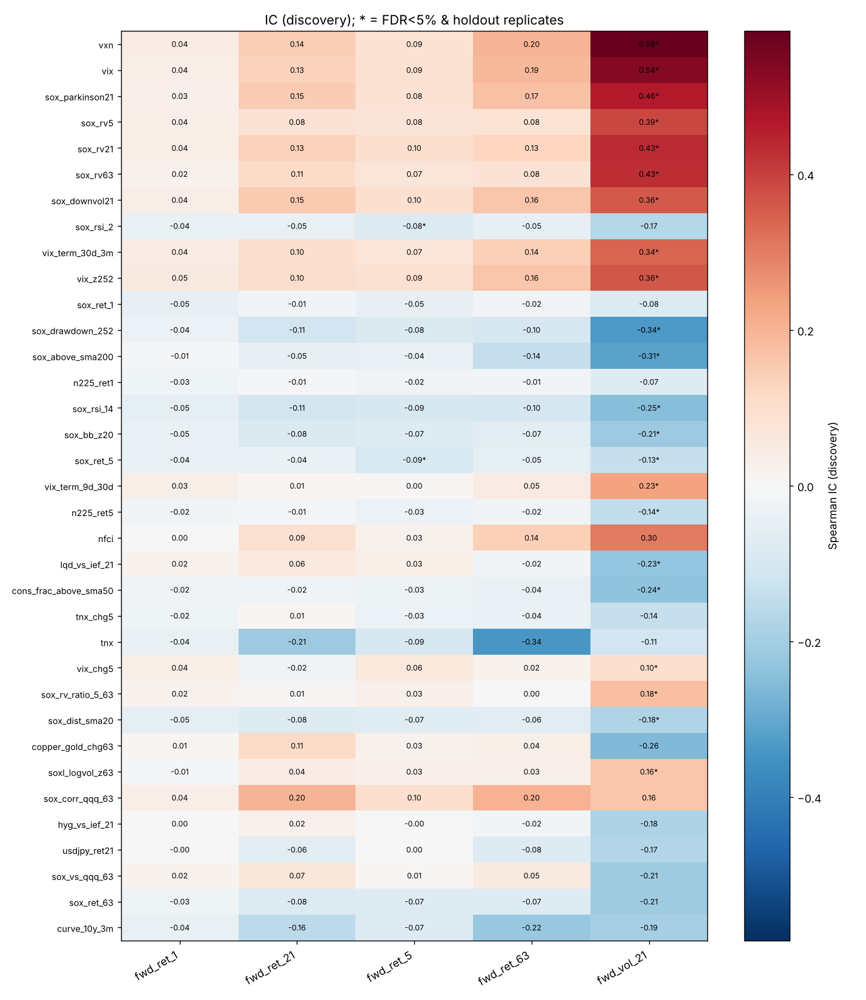
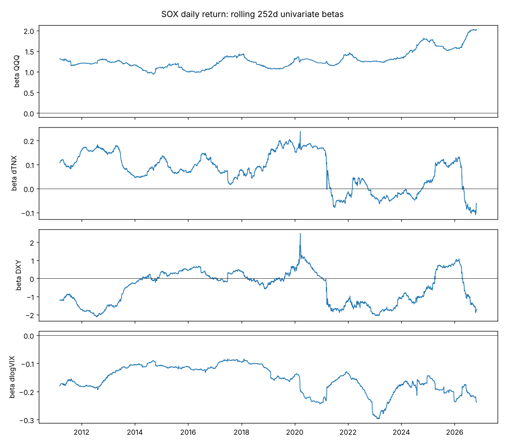
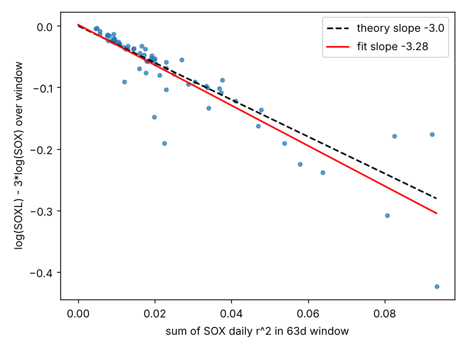
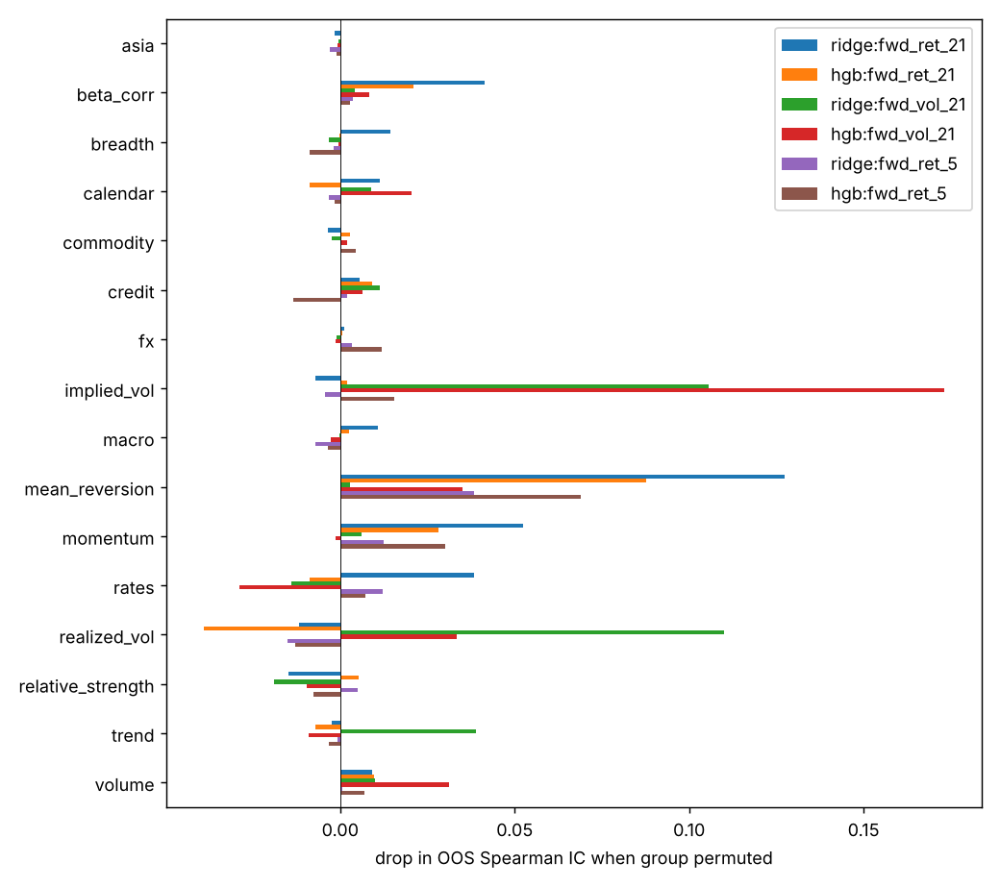
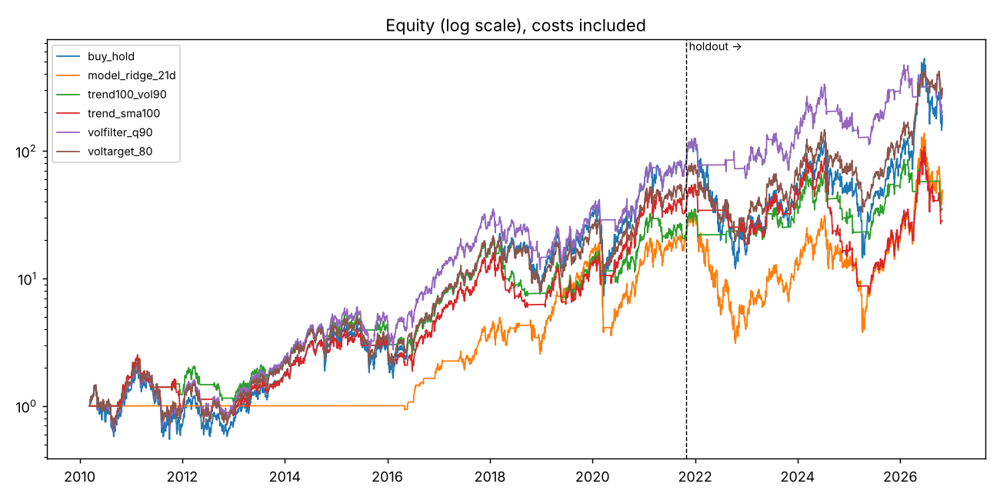

# SOXL ファクター解析レポート

- 解析期間: 2010-03-11 〜 2026-10-28（4185 営業日）・実 SOXL のみ
- 探索期間 / 保留期間の境界: **2021-10-27**（保留期間は検定・パラメータ選択に一切使っていない）
- 特徴量数: 86、バックテスト: リバランス=W、約定遅延=1日、片道コスト=5.0bp

## 1. 単変量の予測力（Spearman IC）

探索期間で Newey-West t 値 → Benjamini-Hochberg FDR 補正。`robust` = FDR<5% かつ保留期間で同符号・IC が探索期間の半分以上残ったもの。

検定数: 415、FDR<5%: 39、robust: 24

### fwd_ret_1（p 値順 上位 12）

| feature | ic_disc | t_hac | q_bh | ic_hold | yearly_sign_consistency | robust |
|---|---|---|---|---|---|---|
| sox_rsi_14 | -0.051 | -2.891 | 0.047 | -0.021 | 0.917 | False |
| vix_z252 | 0.052 | 2.869 | 0.047 | 0.023 | 0.917 | False |
| sox_dist_sma20 | -0.051 | -2.781 | 0.054 | -0.028 | 0.917 | False |
| sox_rsi_2 | -0.043 | -2.585 | 0.082 | -0.034 | 0.750 | False |
| sox_bb_z20 | -0.045 | -2.549 | 0.088 | -0.028 | 0.917 | False |
| curve_10y_3m | -0.044 | -2.523 | 0.091 | 0.001 | 0.667 | False |
| sox_ret_5 | -0.045 | -2.512 | 0.092 | -0.047 | 1.000 | False |
| tnx | -0.043 | -2.500 | 0.092 | 0.039 | 1.000 | False |
| sox_ret_1 | -0.047 | -2.475 | 0.097 | -0.027 | 0.583 | False |
| vxn | 0.042 | 2.461 | 0.097 | 0.002 | 0.917 | False |
| vix_term_30d_3m | 0.043 | 2.431 | 0.099 | 0.047 | 1.000 | False |
| sox_downvol21 | 0.040 | 2.365 | 0.110 | -0.003 | 0.917 | False |

### fwd_ret_21（p 値順 上位 12）

| feature | ic_disc | t_hac | q_bh | ic_hold | yearly_sign_consistency | robust |
|---|---|---|---|---|---|---|
| tnx | -0.210 | -3.218 | 0.019 | 0.173 | 0.917 | False |
| sox_corr_qqq_63 | 0.199 | 3.065 | 0.028 | -0.025 | 0.917 | False |
| vxn | 0.142 | 2.426 | 0.099 | -0.116 | 0.917 | False |
| cal_month_cos | 0.159 | 2.417 | 0.100 | 0.049 | 0.750 | False |
| sox_downvol21 | 0.151 | 2.316 | 0.120 | -0.193 | 0.917 | False |
| sox_parkinson21 | 0.148 | 2.274 | 0.130 | -0.194 | 0.833 | False |
| vix | 0.135 | 2.185 | 0.150 | -0.028 | 0.917 | False |
| curve_10y_3m | -0.155 | -2.170 | 0.150 | -0.146 | 0.667 | False |
| cons_dispersion21 | -0.112 | -2.107 | 0.160 | -0.035 | 0.583 | False |
| sox_rv21 | 0.133 | 2.063 | 0.173 | -0.204 | 0.917 | False |
| btc_ret5 | 0.094 | 1.885 | 0.223 | 0.078 | 0.500 | False |
| icsa_chg21 | -0.093 | -1.876 | 0.224 | -0.014 | 0.917 | False |

### fwd_ret_5（p 値順 上位 12）

| feature | ic_disc | t_hac | q_bh | ic_hold | yearly_sign_consistency | robust |
|---|---|---|---|---|---|---|
| sox_rsi_2 | -0.080 | -3.238 | 0.018 | -0.054 | 0.917 | True |
| sox_ret_5 | -0.087 | -2.975 | 0.037 | -0.046 | 0.750 | True |
| sox_rv21 | 0.097 | 2.882 | 0.047 | -0.054 | 0.917 | False |
| sox_downvol21 | 0.095 | 2.858 | 0.048 | -0.056 | 0.917 | False |
| sox_rsi_14 | -0.093 | -2.834 | 0.050 | 0.001 | 1.000 | False |
| sox_corr_qqq_63 | 0.098 | 2.830 | 0.050 | 0.006 | 0.917 | False |
| sox_ret_1 | -0.047 | -2.758 | 0.056 | -0.048 | 0.917 | False |
| tnx | -0.093 | -2.663 | 0.071 | 0.055 | 0.917 | False |
| vxn | 0.086 | 2.621 | 0.077 | -0.025 | 0.917 | False |
| vix | 0.088 | 2.587 | 0.082 | 0.034 | 0.917 | False |
| vix_z252 | 0.087 | 2.579 | 0.082 | -0.006 | 0.917 | False |
| sox_parkinson21 | 0.085 | 2.539 | 0.089 | -0.065 | 0.917 | False |

### fwd_ret_63（p 値順 上位 12）

| feature | ic_disc | t_hac | q_bh | ic_hold | yearly_sign_consistency | robust |
|---|---|---|---|---|---|---|
| tnx | -0.338 | -3.328 | 0.015 | 0.262 | 0.750 | False |
| cal_month_sin | -0.258 | -2.447 | 0.099 | 0.033 | 0.750 | False |
| vix_z252 | 0.163 | 2.203 | 0.149 | -0.111 | 0.917 | False |
| sox_downvol21 | 0.160 | 2.054 | 0.173 | -0.173 | 0.833 | False |
| vxn | 0.200 | 2.021 | 0.178 | -0.066 | 0.833 | False |
| sox_rsi_2 | -0.050 | -1.965 | 0.193 | -0.036 | 1.000 | False |
| sox_corr_qqq_63 | 0.201 | 1.957 | 0.193 | -0.070 | 0.667 | False |
| vix_term_30d_3m | 0.141 | 1.854 | 0.230 | 0.142 | 0.917 | False |
| curve_10y_3m | -0.220 | -1.803 | 0.253 | -0.290 | 0.667 | False |
| vix | 0.191 | 1.784 | 0.253 | 0.035 | 0.917 | False |
| sox_skew63 | -0.157 | -1.687 | 0.292 | 0.156 | 0.250 | False |
| sox_parkinson21 | 0.172 | 1.677 | 0.292 | -0.170 | 0.750 | False |

### fwd_vol_21（p 値順 上位 12）

| feature | ic_disc | t_hac | q_bh | ic_hold | yearly_sign_consistency | robust |
|---|---|---|---|---|---|---|
| vxn | 0.584 | 11.274 | 0.000 | 0.525 | 0.917 | True |
| vix | 0.536 | 9.107 | 0.000 | 0.418 | 0.833 | True |
| sox_parkinson21 | 0.464 | 7.320 | 0.000 | 0.573 | 0.833 | True |
| sox_rv5 | 0.389 | 7.241 | 0.000 | 0.395 | 0.917 | True |
| sox_rv21 | 0.434 | 6.961 | 0.000 | 0.556 | 0.750 | True |
| sox_rv63 | 0.431 | 6.408 | 0.000 | 0.353 | 0.583 | True |
| sox_downvol21 | 0.360 | 5.595 | 0.000 | 0.560 | 0.750 | True |
| sox_rsi_2 | -0.167 | -5.493 | 0.000 | -0.078 | 0.917 | False |
| vix_term_30d_3m | 0.341 | 5.321 | 0.000 | 0.230 | 0.917 | True |
| vix_z252 | 0.361 | 5.314 | 0.000 | 0.474 | 0.833 | True |
| sox_ret_1 | -0.079 | -5.116 | 0.000 | -0.034 | 0.833 | False |
| sox_drawdown_252 | -0.335 | -4.624 | 0.000 | -0.272 | 0.833 | True |

### 上位ファクターの五分位（fwd_ret_21、対数リターン）

**tnx**

| bin | disc_mean | disc_hit_rate | disc_n | hold_mean | hold_hit_rate | hold_n |
|---|---|---|---|---|---|---|
| Q1 | 0.076 | 0.730 | 586 | -0.143 | 0.304 | 247 |
| Q2 | 0.065 | 0.666 | 586 | 0.043 | 0.575 | 247 |
| Q3 | 0.016 | 0.564 | 585 | 0.069 | 0.611 | 247 |
| Q4 | 0.049 | 0.688 | 586 | 0.066 | 0.579 | 247 |
| Q5 | -0.045 | 0.488 | 586 | 0.027 | 0.526 | 247 |

**sox_corr_qqq_63**

| bin | disc_mean | disc_hit_rate | disc_n | hold_mean | hold_hit_rate | hold_n |
|---|---|---|---|---|---|---|
| Q1 | -0.037 | 0.515 | 586 | 0.091 | 0.607 | 247 |
| Q2 | 0.026 | 0.584 | 586 | 0.034 | 0.502 | 247 |
| Q3 | 0.044 | 0.675 | 585 | -0.098 | 0.445 | 247 |
| Q4 | 0.033 | 0.638 | 586 | -0.059 | 0.413 | 247 |
| Q5 | 0.095 | 0.724 | 586 | 0.093 | 0.628 | 247 |

**vxn**

| bin | disc_mean | disc_hit_rate | disc_n | hold_mean | hold_hit_rate | hold_n |
|---|---|---|---|---|---|---|
| Q1 | 0.024 | 0.637 | 586 | 0.043 | 0.660 | 247 |
| Q2 | 0.007 | 0.551 | 586 | 0.054 | 0.587 | 247 |
| Q3 | 0.008 | 0.591 | 585 | 0.024 | 0.482 | 247 |
| Q4 | 0.048 | 0.664 | 586 | -0.054 | 0.401 | 247 |
| Q5 | 0.075 | 0.693 | 586 | -0.004 | 0.466 | 247 |

**cal_month_cos**

| bin | disc_mean | disc_hit_rate | disc_n | hold_mean | hold_hit_rate | hold_n |
|---|---|---|---|---|---|---|
| Q1 | -0.022 | 0.502 | 586 | -0.057 | 0.478 | 247 |
| Q2 | 0.038 | 0.619 | 586 | 0.025 | 0.534 | 247 |
| Q3 | 0.006 | 0.554 | 585 | 0.038 | 0.482 | 247 |
| Q4 | 0.061 | 0.734 | 586 | 0.005 | 0.482 | 247 |
| Q5 | 0.079 | 0.727 | 586 | 0.050 | 0.619 | 247 |

**sox_downvol21**

| bin | disc_mean | disc_hit_rate | disc_n | hold_mean | hold_hit_rate | hold_n |
|---|---|---|---|---|---|---|
| Q1 | 0.022 | 0.604 | 586 | 0.092 | 0.717 | 247 |
| Q2 | -0.003 | 0.544 | 586 | 0.046 | 0.559 | 247 |
| Q3 | 0.027 | 0.619 | 585 | -0.024 | 0.445 | 247 |
| Q4 | 0.050 | 0.657 | 586 | 0.030 | 0.474 | 247 |
| Q5 | 0.065 | 0.712 | 586 | -0.082 | 0.401 | 247 |

**sox_parkinson21**

| bin | disc_mean | disc_hit_rate | disc_n | hold_mean | hold_hit_rate | hold_n |
|---|---|---|---|---|---|---|
| Q1 | 0.038 | 0.654 | 586 | 0.105 | 0.721 | 247 |
| Q2 | -0.028 | 0.493 | 586 | 0.017 | 0.583 | 247 |
| Q3 | 0.017 | 0.579 | 585 | -0.009 | 0.417 | 247 |
| Q4 | 0.060 | 0.713 | 586 | 0.042 | 0.490 | 247 |
| Q5 | 0.074 | 0.696 | 586 | -0.093 | 0.385 | 247 |

## 2. 同日の値動きの要因分解（^SOX 日次、説明であって予測ではない）

**ex_btc**: R²=0.756, n=4119（2010-03-12〜2026-10-28）

| factor | std_beta | t_hac | r2_alone | delta_r2_drop |
|---|---|---|---|---|
| QQQ | 0.856 | 40.182 | 0.751 | 0.260 |
| COPPER | 0.054 | 5.486 | 0.079 | 0.002 |
| TWII | 0.024 | 1.869 | 0.028 | 0.001 |
| HYG | -0.023 | -1.482 | 0.340 | 0.000 |
| dTNX | 0.015 | 1.163 | 0.031 | 0.000 |
| DXY | -0.009 | -0.877 | 0.021 | 0.000 |
| USDJPY | 0.006 | 0.721 | 0.000 | 0.000 |
| dlogVIX | -0.007 | -0.486 | 0.403 | 0.000 |
| OIL | 0.001 | 0.081 | 0.027 | 0.000 |

**all**: R²=0.758, n=2991（2014-09-18〜2026-10-28）

| factor | std_beta | t_hac | r2_alone | delta_r2_drop |
|---|---|---|---|---|
| QQQ | 0.859 | 34.245 | 0.752 | 0.259 |
| COPPER | 0.063 | 5.926 | 0.063 | 0.003 |
| TWII | 0.021 | 1.412 | 0.023 | 0.000 |
| dTNX | 0.018 | 1.119 | 0.011 | 0.000 |
| HYG | -0.017 | -0.948 | 0.337 | 0.000 |
| USDJPY | 0.010 | 1.116 | 0.000 | 0.000 |
| BTC | 0.007 | 0.765 | 0.049 | 0.000 |
| DXY | -0.005 | -0.434 | 0.006 | 0.000 |
| OIL | -0.001 | -0.064 | 0.016 | 0.000 |
| dlogVIX | 0.001 | 0.076 | 0.390 | 0.000 |

## 3. レバレッジ減価（ボラティリティ・ドラッグ）

- 日次: SOXL = 2.947 × SOX（R²=0.9917）
- 63 日窓の [log SOXL − 3·log SOX] を窓内 Σr² に回帰: 傾き -3.28 ± 0.48（理論値 -3.0）、切片（年率コスト）0.8%、窓数 66
- 合成 3 倍系列との一致: 日次相関 0.9964、年率トラッキング差 2.9%、TE 8.4%

## 4. 季節性（翌日リターン）

**weekday(t)**（Kruskal-Wallis p=0.634）

| Date | mean_bp | hit_rate | n |
|---|---|---|---|
| Friday | 15.07 | 0.53 | 839 |
| Monday | 34.15 | 0.53 | 784 |
| Thursday | -17.58 | 0.52 | 843 |
| Tuesday | 32.55 | 0.57 | 861 |
| Wednesday | -0.89 | 0.54 | 857 |

**month(t)**（Kruskal-Wallis p=0.640）

| Date | mean_bp | hit_rate | n |
|---|---|---|---|
| 1 | 44.48 | 0.58 | 324 |
| 2 | 22.69 | 0.58 | 307 |
| 3 | -29.55 | 0.52 | 364 |
| 4 | -2.17 | 0.53 | 352 |
| 5 | 49.23 | 0.55 | 359 |
| 6 | -1.70 | 0.54 | 359 |
| 7 | 4.95 | 0.52 | 360 |
| 8 | -35.36 | 0.51 | 376 |
| 9 | 12.25 | 0.55 | 348 |
| 10 | 22.23 | 0.55 | 371 |
| 11 | 54.36 | 0.54 | 327 |
| 12 | 18.29 | 0.51 | 337 |

## 5. レジーム別の将来 21 日（閾値は探索期間で決定）

| regime | level | period | n | mean_fwd | median_fwd | hit_rate | mean_fwd_vol |
|---|---|---|---|---|---|---|---|
| SOX vs SMA200 | above | disc | 2312 | 0.026 | 0.058 | 0.628 | 0.687 |
| SOX vs SMA200 | below | disc | 617 | 0.055 | 0.067 | 0.626 | 0.907 |
| SOX vs SMA200 | above | hold | 890 | 0.032 | 0.033 | 0.543 | 1.031 |
| SOX vs SMA200 | below | hold | 345 | -0.039 | -0.031 | 0.458 | 1.267 |
| VIX | <15 | disc | 1179 | 0.014 | 0.038 | 0.597 | 0.594 |
| VIX | 15-20 | disc | 973 | 0.020 | 0.057 | 0.616 | 0.699 |
| VIX | 20-30 | disc | 586 | 0.072 | 0.103 | 0.672 | 0.885 |
| VIX | >30 | disc | 191 | 0.087 | 0.123 | 0.733 | 1.298 |
| VIX | <15 | hold | 276 | 0.024 | 0.071 | 0.609 | 0.895 |
| VIX | 15-20 | hold | 549 | 0.003 | -0.001 | 0.497 | 1.104 |
| VIX | 20-30 | hold | 345 | -0.012 | -0.043 | 0.458 | 1.196 |
| VIX | >30 | hold | 65 | 0.177 | 0.100 | 0.646 | 1.376 |
| SOX RV21 tercile | low | disc | 977 | 0.015 | 0.035 | 0.585 | 0.610 |
| SOX RV21 tercile | mid | disc | 976 | 0.026 | 0.048 | 0.612 | 0.655 |
| SOX RV21 tercile | high | disc | 976 | 0.056 | 0.102 | 0.684 | 0.934 |
| SOX RV21 tercile | low | hold | 18 | 0.110 | 0.074 | 0.944 | 0.874 |
| SOX RV21 tercile | mid | hold | 192 | 0.124 | 0.139 | 0.724 | 0.858 |
| SOX RV21 tercile | high | hold | 1025 | -0.010 | -0.021 | 0.473 | 1.146 |
| SOX drawdown | -40~-20% | disc | 163 | 0.170 | 0.167 | 0.798 | 1.127 |
| SOX drawdown | -20~-10% | disc | 673 | 0.023 | 0.057 | 0.602 | 0.843 |
| SOX drawdown | >-10% | disc | 2093 | 0.024 | 0.054 | 0.622 | 0.667 |
| SOX drawdown | <-40% | hold | 26 | 0.295 | 0.360 | 0.846 | 1.423 |
| SOX drawdown | -40~-20% | hold | 263 | -0.057 | -0.041 | 0.449 | 1.308 |
| SOX drawdown | -20~-10% | hold | 350 | -0.031 | -0.046 | 0.414 | 1.043 |
| SOX drawdown | >-10% | hold | 596 | 0.057 | 0.066 | 0.597 | 1.022 |

## 6. 多変量 walk-forward（拡張窓・h 日パージ・252 日ごと再学習）

| target | model | oos_start | n_oos | n_features | mean_fold_ic | pooled_ic | oos_r2_vs_zero | oos_r2_vs_train_mean | hit_rate | frac_folds_ic_pos |
|---|---|---|---|---|---|---|---|---|---|---|
| fwd_ret_21 | ridge | 2016-04-22 | 2520 | 81 | 0.109 | 0.054 | -0.327 | -0.343 | 0.581 | 0.500 |
| fwd_ret_21 | hgb | 2016-04-22 | 2520 | 81 | 0.093 | 0.029 | -0.160 | -0.173 | 0.509 | 0.600 |
| fwd_vol_21 | ridge | 2016-04-22 | 2520 | 81 | 0.396 | 0.654 | 0.859 | 0.329 | 1.000 | 0.900 |
| fwd_vol_21 | hgb | 2016-04-22 | 2520 | 81 | 0.350 | 0.600 | 0.851 | 0.289 | 1.000 | 1.000 |
| fwd_ret_5 | ridge | 2016-04-22 | 2536 | 81 | 0.064 | 0.014 | -0.028 | -0.029 | 0.558 | 0.636 |
| fwd_ret_5 | hgb | 2016-04-22 | 2536 | 81 | 0.051 | -0.004 | -0.085 | -0.087 | 0.494 | 0.636 |

欠損 >10% のためモデルから除外: btc_ret21, btc_ret5, hy_oas, hy_oas_chg21, hy_oas_z252

グループ置換重要度（OOS IC の低下量、大きいほど重要）

| index | ridge:fwd_ret_21 | hgb:fwd_ret_21 | ridge:fwd_vol_21 | hgb:fwd_vol_21 | ridge:fwd_ret_5 | hgb:fwd_ret_5 |
|---|---|---|---|---|---|---|
| asia | -0.0017 | 0.0001 | -0.0004 | -0.0007 | -0.0030 | -0.0011 |
| beta_corr | 0.0413 | 0.0210 | 0.0043 | 0.0084 | 0.0036 | 0.0027 |
| breadth | 0.0144 | -0.0002 | -0.0033 | -0.0005 | -0.0020 | -0.0088 |
| calendar | 0.0113 | -0.0086 | 0.0089 | 0.0204 | -0.0032 | -0.0015 |
| commodity | -0.0036 | 0.0027 | -0.0024 | 0.0018 | 0.0002 | 0.0045 |
| credit | 0.0055 | 0.0092 | 0.0114 | 0.0064 | 0.0019 | -0.0134 |
| fx | 0.0011 | 0.0006 | -0.0011 | -0.0014 | 0.0034 | 0.0119 |
| implied_vol | -0.0072 | 0.0019 | 0.1055 | 0.1731 | -0.0042 | 0.0153 |
| macro | 0.0109 | 0.0025 | -0.0002 | -0.0028 | -0.0070 | -0.0034 |
| mean_reversion | 0.1274 | 0.0878 | 0.0029 | 0.0349 | 0.0383 | 0.0690 |
| momentum | 0.0524 | 0.0281 | 0.0062 | -0.0013 | 0.0126 | 0.0302 |
| rates | 0.0383 | -0.0089 | -0.0139 | -0.0290 | 0.0122 | 0.0073 |
| realized_vol | -0.0118 | -0.0391 | 0.1099 | 0.0334 | -0.0152 | -0.0130 |
| relative_strength | -0.0148 | 0.0052 | -0.0191 | -0.0097 | 0.0050 | -0.0075 |
| trend | -0.0024 | -0.0072 | 0.0388 | -0.0092 | -0.0009 | -0.0032 |
| volume | 0.0091 | 0.0098 | 0.0100 | 0.0312 | 0.0005 | 0.0070 |

## 7. 低頻度ルールのバックテスト

試行したルール数: 18（多重試行による Sharpe の上振れに注意）。各ファミリーで探索期間 Sharpe 最良を選び、保留期間の成績を見る。

| rule | family | period | CAGR | vol | sharpe | maxDD | calmar | exposure | trades_per_year |
|---|---|---|---|---|---|---|---|---|---|
| buy_hold | buy_hold | disc | 0.453 | 0.797 | 0.867 | -0.804 | 0.563 | 0.999 | 0.086 |
| buy_hold | buy_hold | hold | 0.198 | 1.155 | 0.703 | -0.905 | 0.219 | 1.000 | 0.000 |
| trend_sma100 | trend | disc | 0.354 | 0.577 | 0.808 | -0.666 | 0.531 | 0.739 | 4.732 |
| trend_sma100 | trend | hold | -0.035 | 0.895 | 0.372 | -0.915 | -0.039 | 0.690 | 6.220 |
| volfilter_q90 | volfilter | disc | 0.453 | 0.672 | 0.889 | -0.705 | 0.643 | 0.899 | 3.011 |
| volfilter_q90 | volfilter | hold | 0.213 | 0.744 | 0.585 | -0.666 | 0.321 | 0.584 | 6.621 |
| trend100_vol90 | trend_vol | disc | 0.302 | 0.547 | 0.750 | -0.676 | 0.447 | 0.706 | 5.076 |
| trend100_vol90 | trend_vol | hold | 0.102 | 0.671 | 0.426 | -0.712 | 0.143 | 0.492 | 7.825 |
| voltarget_80 | voltarget | disc | 0.401 | 0.676 | 0.833 | -0.687 | 0.583 | 0.926 | 18.068 |
| voltarget_80 | voltarget | hold | 0.441 | 0.819 | 0.811 | -0.775 | 0.569 | 0.764 | 43.939 |
| model_ridge_21d | model | disc | 0.721 | 0.755 | 1.098 | -0.814 | 0.885 | 0.733 | 4.898 |
| model_ridge_21d | model | hold | 0.198 | 1.155 | 0.703 | -0.905 | 0.219 | 1.000 | 0.000 |

保留期間の Sharpe 90% 区間（定常ブロック・ブートストラップ、ブロック 21 日）

| rule | sharpe_lo | sharpe_hi | diff_lo | diff_hi | p_diff_le0 |
|---|---|---|---|---|---|
| buy_hold | 0.071 | 1.399 |  |  |  |
| model_ridge_21d | 0.071 | 1.399 | 0.000 | 0.000 | 1.000 |
| trend100_vol90 | -0.283 | 1.071 | -0.917 | 0.309 | 0.778 |
| trend_sma100 | -0.350 | 1.136 | -0.798 | 0.108 | 0.894 |
| volfilter_q90 | -0.063 | 1.216 | -0.688 | 0.406 | 0.644 |
| voltarget_80 | 0.153 | 1.514 | -0.075 | 0.278 | 0.170 |

全ルールの成績は `backtest.csv`。
