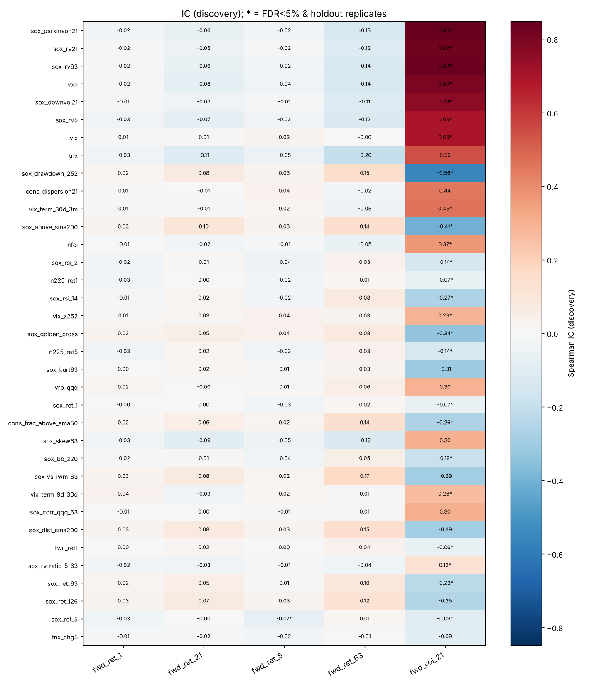
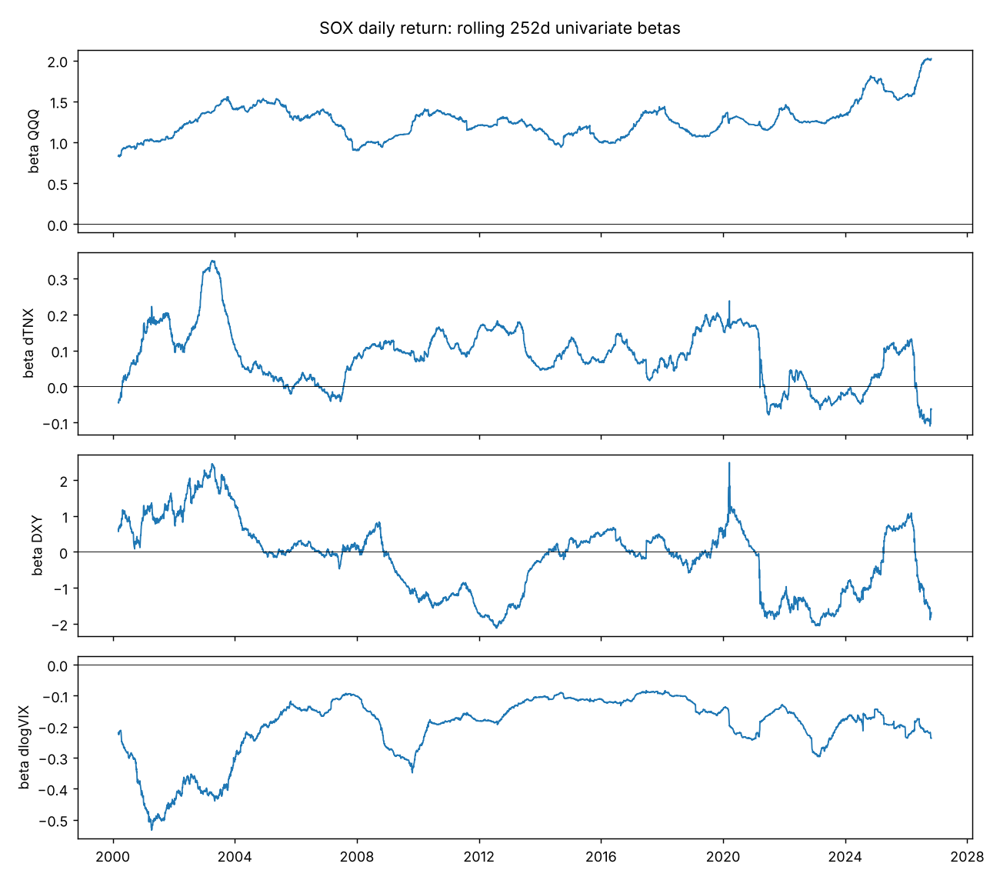
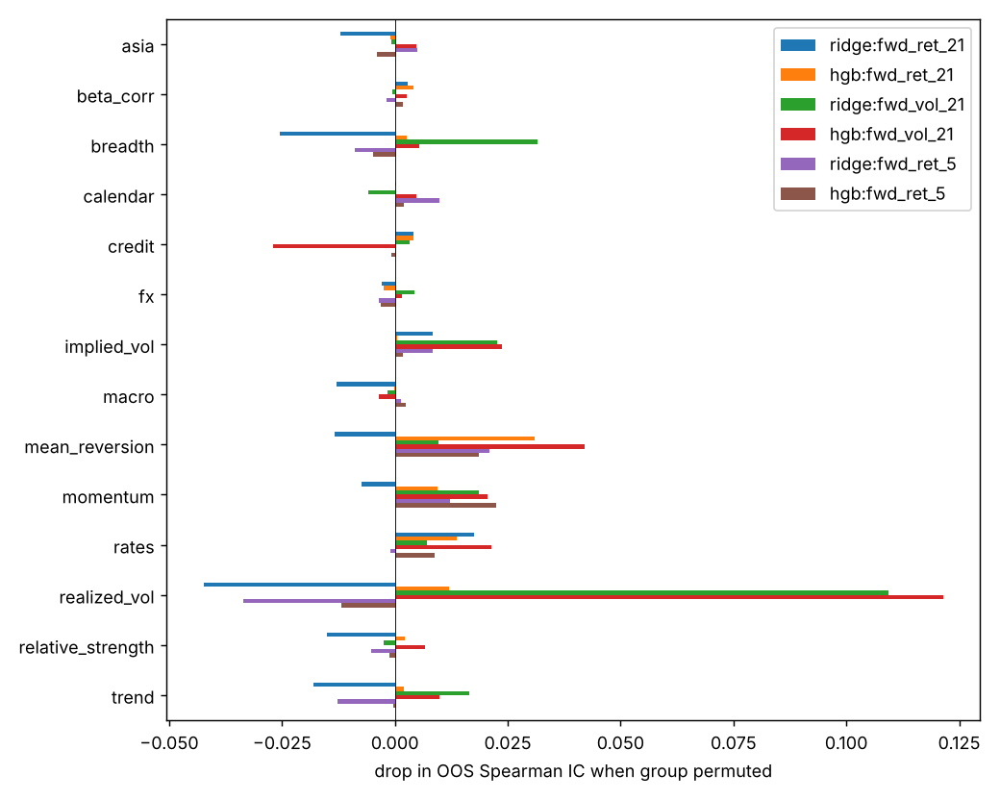
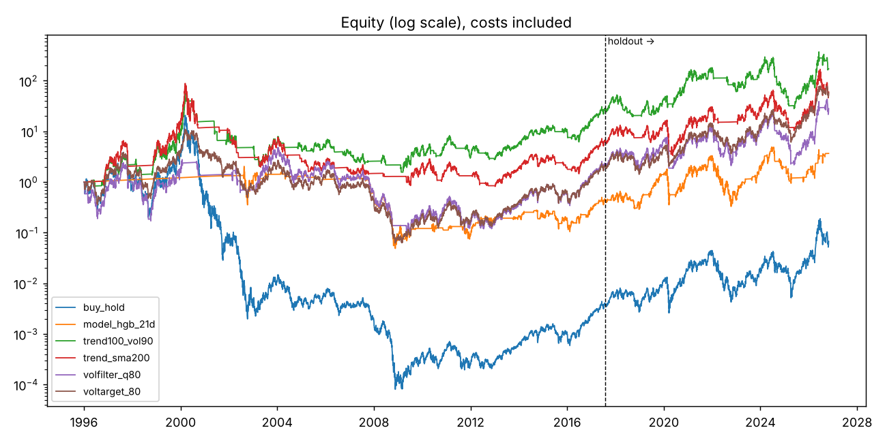

# SOXL ファクター解析レポート

- 解析期間: 1996-01-02 〜 2026-10-28（7757 営業日）・上場前は ^SOX から合成した 3 倍系列
- 探索期間 / 保留期間の境界: **2017-07-26**（保留期間は検定・パラメータ選択に一切使っていない）
- 特徴量数: 86、バックテスト: リバランス=W、約定遅延=1日、片道コスト=5.0bp

## 1. 単変量の予測力（Spearman IC）

探索期間で Newey-West t 値 → Benjamini-Hochberg FDR 補正。`robust` = FDR<5% かつ保留期間で同符号・IC が探索期間の半分以上残ったもの。

検定数: 415、FDR<5%: 43、robust: 30

### fwd_ret_1（p 値順 上位 12）

| feature | ic_disc | t_hac | q_bh | ic_hold | yearly_sign_consistency | robust |
|---|---|---|---|---|---|---|
| cal_dow_tue | 0.043 | 3.103 | 0.020 | 0.009 | 0.682 | False |
| sox_skew63 | -0.030 | -2.388 | 0.138 | 0.011 | 0.455 | False |
| cal_turn_of_month | 0.033 | 2.359 | 0.142 | 0.021 | 0.682 | False |
| sox_ret_5 | -0.033 | -2.355 | 0.142 | -0.054 | 0.864 | False |
| n225_ret1 | -0.033 | -2.308 | 0.154 | -0.038 | 0.727 | False |
| sox_sma200_slope21 | 0.032 | 2.303 | 0.154 | 0.013 | 0.318 | False |
| sox_golden_cross | 0.030 | 2.291 | 0.155 | 0.009 | 0.353 | False |
| cal_month_cos | 0.029 | 2.239 | 0.169 | 0.002 | 0.591 | False |
| sox_rv5 | -0.029 | -2.201 | 0.175 | 0.020 | 0.455 | False |
| sox_above_sma200 | 0.029 | 2.171 | 0.185 | -0.003 | 0.368 | False |
| cal_dow_thu | -0.027 | -2.128 | 0.201 | -0.026 | 0.636 | False |
| sox_vs_iwm_63 | 0.033 | 2.113 | 0.205 | -0.018 | 0.333 | False |

### fwd_ret_21（p 値順 上位 12）

| feature | ic_disc | t_hac | q_bh | ic_hold | yearly_sign_consistency | robust |
|---|---|---|---|---|---|---|
| cal_month_cos | 0.136 | 2.586 | 0.084 | 0.038 | 0.727 | False |
| copper_gold_chg63 | 0.121 | 2.200 | 0.175 | -0.045 | 0.588 | False |
| cal_dow_wed | -0.009 | -1.979 | 0.239 | -0.002 | 0.545 | False |
| tnx | -0.108 | -1.952 | 0.248 | -0.043 | 0.727 | False |
| sox_above_sma200 | 0.100 | 1.943 | 0.251 | 0.041 | 0.316 | False |
| cal_dow_thu | -0.009 | -1.758 | 0.329 | 0.002 | 0.682 | False |
| sox_skew63 | -0.088 | -1.744 | 0.330 | 0.087 | 0.455 | False |
| sox_rv5 | -0.074 | -1.656 | 0.383 | -0.027 | 0.409 | False |
| copper_gold_chg21 | 0.077 | 1.548 | 0.451 | 0.016 | 0.556 | False |
| sox_drawdown_252 | 0.078 | 1.507 | 0.451 | -0.006 | 0.182 | False |
| twii_ret1 | 0.025 | 1.492 | 0.451 | -0.005 | 0.571 | False |
| soxl_logvol_z63 | 0.084 | 1.485 | 0.451 | -0.042 | 0.625 | False |

### fwd_ret_5（p 値順 上位 12）

| feature | ic_disc | t_hac | q_bh | ic_hold | yearly_sign_consistency | robust |
|---|---|---|---|---|---|---|
| sox_ret_5 | -0.068 | -2.806 | 0.048 | -0.059 | 0.727 | True |
| cal_month_cos | 0.068 | 2.644 | 0.072 | 0.009 | 0.727 | False |
| sox_rsi_2 | -0.044 | -2.247 | 0.168 | -0.065 | 0.818 | False |
| vix_chg5 | 0.046 | 2.130 | 0.201 | 0.013 | 0.636 | False |
| sox_skew63 | -0.046 | -1.874 | 0.287 | 0.044 | 0.500 | False |
| tnx | -0.047 | -1.848 | 0.298 | -0.022 | 0.773 | False |
| gold_ret21 | -0.051 | -1.815 | 0.312 | -0.007 | 0.667 | False |
| sox_ret_1 | -0.025 | -1.774 | 0.329 | -0.050 | 0.773 | False |
| sox_bb_z20 | -0.038 | -1.558 | 0.446 | -0.047 | 0.727 | False |
| n225_ret1 | -0.021 | -1.537 | 0.451 | -0.021 | 0.636 | False |
| n225_ret5 | -0.034 | -1.519 | 0.451 | -0.016 | 0.636 | False |
| soxl_logvol_z63 | 0.056 | 1.518 | 0.451 | -0.008 | 0.625 | False |

### fwd_ret_63（p 値順 上位 12）

| feature | ic_disc | t_hac | q_bh | ic_hold | yearly_sign_consistency | robust |
|---|---|---|---|---|---|---|
| twii_ret1 | 0.040 | 2.339 | 0.146 | -0.008 | 0.333 | False |
| cons_frac_above_sma50 | 0.135 | 2.229 | 0.170 | 0.004 | 0.455 | False |
| twii_ret5 | 0.076 | 2.081 | 0.216 | -0.012 | 0.476 | False |
| sox_vs_iwm_63 | 0.167 | 2.037 | 0.235 | 0.123 | 0.278 | False |
| copper_gold_chg21 | 0.118 | 2.018 | 0.236 | -0.045 | 0.611 | False |
| tnx | -0.203 | -2.004 | 0.237 | -0.045 | 0.545 | False |
| icsa_chg21 | -0.084 | -1.989 | 0.239 | -0.026 | 0.545 | False |
| sox_above_sma200 | 0.140 | 1.812 | 0.312 | 0.032 | 0.316 | False |
| sox_drawdown_252 | 0.149 | 1.800 | 0.317 | -0.033 | 0.136 | False |
| cal_month_cos | 0.141 | 1.791 | 0.320 | 0.060 | 0.682 | False |
| sox_rv5 | -0.123 | -1.760 | 0.329 | -0.019 | 0.318 | False |
| sox_dist_sma200 | 0.146 | 1.755 | 0.329 | -0.023 | 0.136 | False |

### fwd_vol_21（p 値順 上位 12）

| feature | ic_disc | t_hac | q_bh | ic_hold | yearly_sign_consistency | robust |
|---|---|---|---|---|---|---|
| sox_parkinson21 | 0.848 | 34.691 | 0.000 | 0.575 | 0.909 | True |
| sox_rv21 | 0.818 | 33.469 | 0.000 | 0.580 | 0.818 | True |
| sox_rv63 | 0.829 | 29.752 | 0.000 | 0.444 | 0.773 | True |
| vxn | 0.798 | 24.836 | 0.000 | 0.528 | 0.941 | True |
| sox_downvol21 | 0.757 | 24.254 | 0.000 | 0.534 | 0.818 | True |
| sox_rv5 | 0.694 | 22.866 | 0.000 | 0.469 | 0.818 | True |
| vix | 0.690 | 17.559 | 0.000 | 0.459 | 0.818 | True |
| tnx | 0.550 | 10.989 | 0.000 | 0.183 | 0.318 | False |
| sox_drawdown_252 | -0.556 | -10.569 | 0.000 | -0.346 | 0.909 | True |
| cons_dispersion21 | 0.445 | 10.444 | 0.000 | 0.191 | 0.727 | False |
| vix_term_30d_3m | 0.458 | 7.279 | 0.000 | 0.334 | 0.833 | True |
| sox_above_sma200 | -0.405 | -6.933 | 0.000 | -0.382 | 0.895 | True |

### 上位ファクターの五分位（fwd_ret_21、対数リターン）

**cal_month_cos**

| bin | disc_mean | disc_hit_rate | disc_n | hold_mean | hold_hit_rate | hold_n |
|---|---|---|---|---|---|---|
| Q1 | -0.077 | 0.419 | 1086 | 0.006 | 0.602 | 462 |
| Q2 | -0.047 | 0.514 | 1086 | 0.017 | 0.557 | 461 |
| Q3 | -0.057 | 0.493 | 1085 | 0.042 | 0.536 | 461 |
| Q4 | 0.028 | 0.567 | 1086 | -0.005 | 0.523 | 461 |
| Q5 | 0.048 | 0.631 | 1086 | 0.078 | 0.671 | 462 |

**copper_gold_chg63**

| bin | disc_mean | disc_hit_rate | disc_n | hold_mean | hold_hit_rate | hold_n |
|---|---|---|---|---|---|---|
| Q1 | -0.083 | 0.425 | 838 | 0.072 | 0.647 | 462 |
| Q2 | -0.046 | 0.504 | 837 | 0.036 | 0.601 | 461 |
| Q3 | -0.019 | 0.561 | 838 | -0.019 | 0.482 | 461 |
| Q4 | 0.001 | 0.532 | 837 | -0.017 | 0.486 | 461 |
| Q5 | 0.028 | 0.609 | 838 | 0.064 | 0.673 | 462 |

**cal_dow_wed**

| bin | disc_mean | disc_hit_rate | disc_n | hold_mean | hold_hit_rate | hold_n |
|---|---|---|---|---|---|---|
| Q1 | -0.020 | 0.515 | 1086 | 0.032 | 0.597 | 462 |
| Q2 | -0.062 | 0.466 | 1086 | 0.034 | 0.653 | 461 |
| Q3 | -0.038 | 0.492 | 1085 | 0.014 | 0.523 | 461 |
| Q4 | 0.036 | 0.634 | 1086 | 0.033 | 0.557 | 461 |
| Q5 | -0.020 | 0.517 | 1086 | 0.023 | 0.558 | 462 |

**tnx**

| bin | disc_mean | disc_hit_rate | disc_n | hold_mean | hold_hit_rate | hold_n |
|---|---|---|---|---|---|---|
| Q1 | 0.037 | 0.610 | 1086 | 0.057 | 0.701 | 462 |
| Q2 | 0.038 | 0.649 | 1086 | 0.016 | 0.581 | 461 |
| Q3 | -0.058 | 0.445 | 1085 | -0.040 | 0.453 | 461 |
| Q4 | -0.080 | 0.424 | 1086 | 0.050 | 0.597 | 461 |
| Q5 | -0.041 | 0.494 | 1086 | 0.053 | 0.556 | 462 |

**sox_above_sma200**

| bin | disc_mean | disc_hit_rate | disc_n | hold_mean | hold_hit_rate | hold_n |
|---|---|---|---|---|---|---|
| Q1 | -0.132 | 0.413 | 1086 | -0.008 | 0.504 | 462 |
| Q2 | -0.026 | 0.520 | 1086 | 0.025 | 0.584 | 461 |
| Q3 | 0.044 | 0.582 | 1085 | 0.043 | 0.705 | 461 |
| Q4 | -0.021 | 0.474 | 1086 | 0.043 | 0.562 | 461 |
| Q5 | 0.030 | 0.635 | 1086 | 0.033 | 0.535 | 462 |

**cal_dow_thu**

| bin | disc_mean | disc_hit_rate | disc_n | hold_mean | hold_hit_rate | hold_n |
|---|---|---|---|---|---|---|
| Q1 | -0.019 | 0.509 | 1086 | 0.032 | 0.593 | 462 |
| Q2 | -0.065 | 0.458 | 1086 | 0.035 | 0.653 | 461 |
| Q3 | -0.031 | 0.512 | 1085 | 0.017 | 0.525 | 461 |
| Q4 | 0.035 | 0.629 | 1086 | 0.027 | 0.534 | 461 |
| Q5 | -0.024 | 0.517 | 1086 | 0.025 | 0.584 | 462 |

## 2. 同日の値動きの要因分解（^SOX 日次、説明であって予測ではない）

**ex_btc**: R²=0.751, n=4839（2007-04-12〜2026-10-28）

| factor | std_beta | t_hac | r2_alone | delta_r2_drop |
|---|---|---|---|---|
| QQQ | 0.849 | 46.326 | 0.745 | 0.283 |
| USDJPY | -0.037 | -2.545 | 0.007 | 0.001 |
| COPPER | 0.041 | 3.962 | 0.076 | 0.001 |
| TWII | 0.030 | 2.714 | 0.025 | 0.001 |
| HYG | -0.037 | -2.466 | 0.252 | 0.001 |
| dlogVIX | -0.031 | -2.256 | 0.402 | 0.000 |
| dTNX | 0.010 | 0.885 | 0.046 | 0.000 |
| DXY | -0.008 | -0.835 | 0.022 | 0.000 |
| OIL | 0.007 | 0.481 | 0.033 | 0.000 |

**all**: R²=0.758, n=2991（2014-09-18〜2026-10-28）

| factor | std_beta | t_hac | r2_alone | delta_r2_drop |
|---|---|---|---|---|
| QQQ | 0.859 | 34.245 | 0.752 | 0.259 |
| COPPER | 0.063 | 5.926 | 0.063 | 0.003 |
| TWII | 0.021 | 1.412 | 0.023 | 0.000 |
| dTNX | 0.018 | 1.119 | 0.011 | 0.000 |
| HYG | -0.017 | -0.948 | 0.337 | 0.000 |
| USDJPY | 0.010 | 1.116 | 0.000 | 0.000 |
| BTC | 0.007 | 0.765 | 0.049 | 0.000 |
| DXY | -0.005 | -0.434 | 0.006 | 0.000 |
| OIL | -0.001 | -0.064 | 0.016 | 0.000 |
| dlogVIX | 0.001 | 0.076 | 0.390 | 0.000 |

## 3. レバレッジ減価（ボラティリティ・ドラッグ）

- 日次: SOXL = 2.947 × SOX（R²=0.9917）
- 63 日窓の [log SOXL − 3·log SOX] を窓内 Σr² に回帰: 傾き -3.28 ± 0.48（理論値 -3.0）、切片（年率コスト）0.8%、窓数 66
- 合成 3 倍系列との一致: 日次相関 0.9964、年率トラッキング差 2.9%、TE 8.4%

## 4. 季節性（翌日リターン）

**weekday(t)**（Kruskal-Wallis p=0.020）

| Date | mean_bp | hit_rate | n |
|---|---|---|---|
| Friday | -5.70 | 0.51 | 1552 |
| Monday | -11.32 | 0.51 | 1459 |
| Thursday | -35.10 | 0.49 | 1560 |
| Tuesday | 34.34 | 0.56 | 1594 |
| Wednesday | -1.73 | 0.52 | 1591 |

**month(t)**（Kruskal-Wallis p=0.504）

| Date | mean_bp | hit_rate | n |
|---|---|---|---|
| 1 | 31.06 | 0.55 | 630 |
| 2 | -2.09 | 0.54 | 595 |
| 3 | -26.97 | 0.50 | 676 |
| 4 | 15.78 | 0.52 | 643 |
| 5 | 9.45 | 0.52 | 655 |
| 6 | -20.76 | 0.50 | 657 |
| 7 | -21.50 | 0.52 | 658 |
| 8 | -28.46 | 0.50 | 684 |
| 9 | -48.32 | 0.51 | 630 |
| 10 | 5.33 | 0.52 | 683 |
| 11 | 40.55 | 0.54 | 611 |
| 12 | 7.44 | 0.51 | 634 |

## 5. レジーム別の将来 21 日（閾値は探索期間で決定）

| regime | level | period | n | mean_fwd | median_fwd | hit_rate | mean_fwd_vol |
|---|---|---|---|---|---|---|---|
| SOX vs SMA200 | above | disc | 3178 | 0.017 | 0.031 | 0.559 | 0.860 |
| SOX vs SMA200 | below | disc | 2251 | -0.074 | -0.022 | 0.476 | 1.277 |
| SOX vs SMA200 | above | hold | 1837 | 0.035 | 0.062 | 0.594 | 0.918 |
| SOX vs SMA200 | below | hold | 470 | -0.001 | 0.006 | 0.513 | 1.255 |
| VIX | <15 | disc | 1503 | 0.006 | 0.025 | 0.557 | 0.635 |
| VIX | 15-20 | disc | 1523 | -0.032 | 0.010 | 0.515 | 0.875 |
| VIX | 20-30 | disc | 1854 | -0.042 | -0.007 | 0.495 | 1.304 |
| VIX | >30 | disc | 549 | 0.009 | 0.038 | 0.566 | 1.643 |
| VIX | <15 | hold | 660 | 0.006 | 0.050 | 0.580 | 0.773 |
| VIX | 15-20 | hold | 869 | 0.014 | 0.033 | 0.545 | 0.992 |
| VIX | 20-30 | hold | 624 | 0.035 | 0.059 | 0.575 | 1.091 |
| VIX | >30 | hold | 154 | 0.162 | 0.164 | 0.760 | 1.446 |
| SOX RV21 tercile | low | disc | 1810 | 0.003 | 0.028 | 0.564 | 0.622 |
| SOX RV21 tercile | mid | disc | 1809 | -0.012 | 0.014 | 0.520 | 0.902 |
| SOX RV21 tercile | high | disc | 1810 | -0.053 | -0.012 | 0.490 | 1.574 |
| SOX RV21 tercile | low | hold | 633 | 0.050 | 0.061 | 0.629 | 0.741 |
| SOX RV21 tercile | mid | hold | 1043 | 0.032 | 0.060 | 0.584 | 0.928 |
| SOX RV21 tercile | high | hold | 631 | -0.003 | 0.018 | 0.517 | 1.330 |
| SOX drawdown | <-40% | disc | 755 | -0.087 | -0.032 | 0.474 | 1.796 |
| SOX drawdown | -40~-20% | disc | 1189 | -0.066 | -0.022 | 0.476 | 1.163 |
| SOX drawdown | -20~-10% | disc | 1114 | -0.027 | 0.003 | 0.504 | 0.879 |
| SOX drawdown | >-10% | disc | 2371 | 0.026 | 0.036 | 0.575 | 0.797 |
| SOX drawdown | <-40% | hold | 26 | 0.295 | 0.360 | 0.846 | 1.423 |
| SOX drawdown | -40~-20% | hold | 295 | -0.023 | 0.000 | 0.498 | 1.356 |
| SOX drawdown | -20~-10% | hold | 524 | 0.007 | 0.006 | 0.508 | 1.058 |
| SOX drawdown | >-10% | hold | 1462 | 0.040 | 0.071 | 0.614 | 0.878 |

## 6. 多変量 walk-forward（拡張窓・h 日パージ・252 日ごと再学習）

| target | model | oos_start | n_oos | n_features | mean_fold_ic | pooled_ic | oos_r2_vs_zero | oos_r2_vs_train_mean | hit_rate | frac_folds_ic_pos |
|---|---|---|---|---|---|---|---|---|---|---|
| fwd_ret_21 | ridge | 2002-08-07 | 5899 | 57 | -0.106 | 0.021 | -0.049 | -0.012 | 0.480 | 0.333 |
| fwd_ret_21 | hgb | 2002-08-07 | 5899 | 57 | 0.066 | -0.016 | -0.462 | -0.411 | 0.501 | 0.583 |
| fwd_vol_21 | ridge | 2002-08-07 | 5899 | 57 | 0.330 | 0.681 | 0.897 | 0.669 | 1.000 | 0.792 |
| fwd_vol_21 | hgb | 2002-08-07 | 5899 | 57 | 0.310 | 0.638 | 0.890 | 0.645 | 1.000 | 0.792 |
| fwd_ret_5 | ridge | 2002-08-07 | 5915 | 57 | 0.004 | 0.033 | -0.008 | -0.001 | 0.479 | 0.500 |
| fwd_ret_5 | hgb | 2002-08-07 | 5915 | 57 | 0.026 | -0.009 | -0.117 | -0.109 | 0.503 | 0.708 |

欠損 >10% のためモデルから除外: breakeven10y_chg21, btc_ret21, btc_ret5, copper_gold_chg21, copper_gold_chg63, gold_ret21, hy_oas, hy_oas_chg21, hy_oas_z252, hyg_vs_ief_21, lqd_vs_ief_21, nvda_vs_sox_21, oil_ret21, real10y_chg21, sox_beta_qqq_63, sox_corr_qqq_63, sox_vs_iwm_63, sox_vs_qqq_126, sox_vs_qqq_21, sox_vs_qqq_63, soxl_dollarvol_21_252, soxl_logvol_z63, tlt_ret21, usdkrw_ret21, usdtwd_ret21, vix_term_30d_3m, vix_term_9d_30d, vrp_qqq, vxn

グループ置換重要度（OOS IC の低下量、大きいほど重要）

| index | ridge:fwd_ret_21 | hgb:fwd_ret_21 | ridge:fwd_vol_21 | hgb:fwd_vol_21 | ridge:fwd_ret_5 | hgb:fwd_ret_5 |
|---|---|---|---|---|---|---|
| asia | -0.0121 | -0.0011 | -0.0009 | 0.0048 | 0.0050 | -0.0040 |
| beta_corr | 0.0029 | 0.0040 | -0.0006 | 0.0025 | -0.0018 | 0.0018 |
| breadth | -0.0255 | 0.0027 | 0.0315 | 0.0054 | -0.0088 | -0.0048 |
| calendar | 0.0002 | -0.0000 | -0.0059 | 0.0048 | 0.0099 | 0.0020 |
| credit | 0.0040 | 0.0041 | 0.0033 | -0.0269 | 0.0002 | -0.0008 |
| fx | -0.0030 | -0.0025 | 0.0043 | 0.0016 | -0.0036 | -0.0032 |
| implied_vol | 0.0084 | 0.0005 | 0.0227 | 0.0238 | 0.0084 | 0.0018 |
| macro | -0.0129 | -0.0001 | -0.0015 | -0.0036 | 0.0013 | 0.0024 |
| mean_reversion | -0.0133 | 0.0309 | 0.0096 | 0.0421 | 0.0208 | 0.0187 |
| momentum | -0.0075 | 0.0095 | 0.0186 | 0.0206 | 0.0122 | 0.0225 |
| rates | 0.0175 | 0.0137 | 0.0070 | 0.0213 | -0.0011 | 0.0089 |
| realized_vol | -0.0424 | 0.0121 | 0.1093 | 0.1214 | -0.0336 | -0.0118 |
| relative_strength | -0.0150 | 0.0022 | -0.0025 | 0.0067 | -0.0052 | -0.0012 |
| trend | -0.0181 | 0.0021 | 0.0164 | 0.0098 | -0.0128 | -0.0005 |

## 7. 低頻度ルールのバックテスト

試行したルール数: 18（多重試行による Sharpe の上振れに注意）。各ファミリーで探索期間 Sharpe 最良を選び、保留期間の成績を見る。

| rule | family | period | CAGR | vol | sharpe | maxDD | calmar | exposure | trades_per_year |
|---|---|---|---|---|---|---|---|---|---|
| buy_hold | buy_hold | disc | -0.227 | 1.166 | 0.341 | -1.000 | -0.227 | 0.999 | 0.046 |
| buy_hold | buy_hold | hold | 0.361 | 1.064 | 0.804 | -0.905 | 0.399 | 1.000 | 0.000 |
| trend_sma200 | trend | disc | 0.090 | 0.714 | 0.449 | -0.991 | 0.091 | 0.581 | 3.574 |
| trend_sma200 | trend | hold | 0.273 | 0.879 | 0.695 | -0.841 | 0.325 | 0.800 | 3.464 |
| volfilter_q80 | volfilter | disc | 0.039 | 0.810 | 0.425 | -0.981 | 0.040 | 0.801 | 2.274 |
| volfilter_q80 | volfilter | hold | 0.313 | 0.919 | 0.740 | -0.914 | 0.343 | 0.890 | 2.381 |
| trend100_vol90 | trend_vol | disc | 0.166 | 0.685 | 0.536 | -0.972 | 0.171 | 0.587 | 5.617 |
| trend100_vol90 | trend_vol | hold | 0.220 | 0.779 | 0.617 | -0.905 | 0.243 | 0.721 | 6.170 |
| voltarget_80 | voltarget | disc | 0.035 | 0.756 | 0.395 | -0.994 | 0.035 | 0.800 | 32.121 |
| voltarget_80 | voltarget | hold | 0.431 | 0.784 | 0.821 | -0.775 | 0.557 | 0.819 | 35.289 |
| model_hgb_21d | model | disc | -0.071 | 0.644 | 0.189 | -0.976 | -0.073 | 0.410 | 8.360 |
| model_hgb_21d | model | hold | 0.257 | 0.873 | 0.672 | -0.901 | 0.285 | 0.658 | 7.902 |

保留期間の Sharpe 90% 区間（定常ブロック・ブートストラップ、ブロック 21 日）

| rule | sharpe_lo | sharpe_hi | diff_lo | diff_hi | p_diff_le0 |
|---|---|---|---|---|---|
| buy_hold | 0.346 | 1.264 |  |  |  |
| model_hgb_21d | 0.200 | 1.152 | -0.431 | 0.178 | 0.752 |
| trend100_vol90 | 0.060 | 1.142 | -0.547 | 0.166 | 0.823 |
| trend_sma200 | 0.201 | 1.202 | -0.378 | 0.169 | 0.760 |
| volfilter_q80 | 0.179 | 1.275 | -0.301 | 0.170 | 0.698 |
| voltarget_80 | 0.326 | 1.308 | -0.114 | 0.147 | 0.438 |

全ルールの成績は `backtest.csv`。
