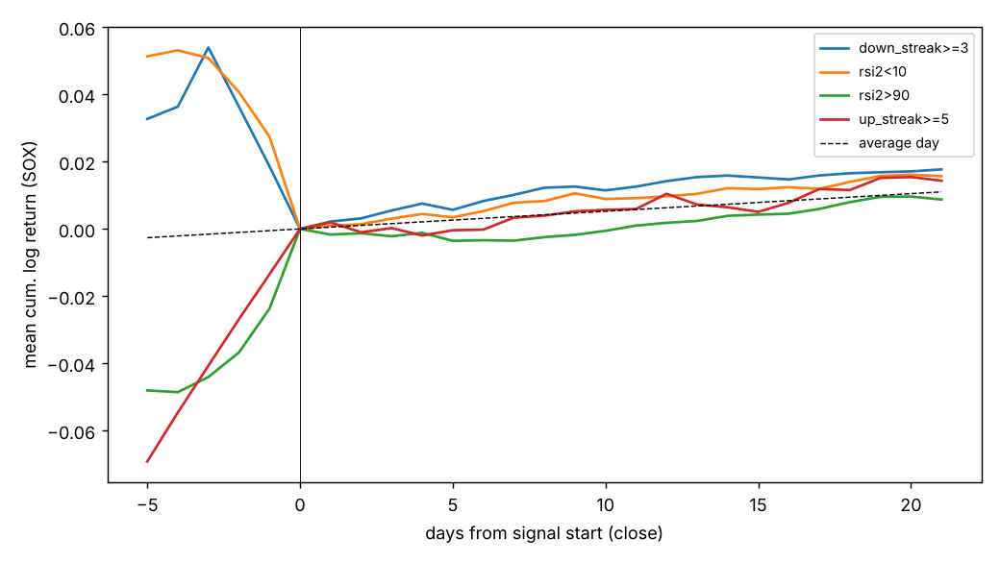

# 底・天井シグナル解析（SOX）

- 期間 1995-12-29〜2026-10-28、探索/保留の境界 **2017-07-26**
- 約定: シグナル日の引けで判定 → 翌営業日の寄付きで買い。リターンは寄付きから h 日後の引けまでの対数リターン
- 閾値の分位点は探索期間のみから計算。`excess` = シグナル日の平均 − 同期間の全日平均

検定数 390、FDR<5% 0、robust 0

## 底シグナル（5 日先、p 値順 上位 15）

| signal | h | n_disc | episodes_disc | excess_disc | hit_disc | base_hit_disc | t_hac | q_bh | n_hold | excess_hold | hit_hold | base_hit_hold | robust |
|---|---|---|---|---|---|---|---|---|---|---|---|---|---|
| drawdown_252 bottom5% | 5 | 272 | 43 | 0.025 | 0.599 | 0.534 | 2.935 | 0.368 | 0 |  |  | 0.573 | False |
| rsi2 bottom10% | 5 | 543 | 291 | 0.007 | 0.571 | 0.534 | 2.336 | 0.555 | 182 | -0.003 | 0.549 | 0.573 | False |
| ibs bottom5% | 5 | 272 | 263 | 0.008 | 0.581 | 0.534 | 2.253 | 0.555 | 87 | 0.008 | 0.678 | 0.573 | False |
| rsi3 bottom10% | 5 | 543 | 280 | 0.007 | 0.580 | 0.534 | 1.931 | 0.601 | 181 | -0.004 | 0.525 | 0.573 | False |
| down_streak>=2 | 5 | 1268 | 661 | 0.003 | 0.554 | 0.534 | 1.829 | 0.601 | 465 | 0.003 | 0.606 | 0.573 | False |
| dist_sma20 bottom10% | 5 | 543 | 145 | 0.008 | 0.576 | 0.534 | 1.662 | 0.677 | 176 | 0.011 | 0.625 | 0.573 | False |
| rsi2<10 | 5 | 634 | 334 | 0.005 | 0.573 | 0.534 | 1.658 | 0.677 | 216 | -0.003 | 0.565 | 0.573 | False |
| ibs bottom10% | 5 | 543 | 505 | 0.004 | 0.547 | 0.534 | 1.627 | 0.677 | 202 | 0.009 | 0.683 | 0.573 | False |
| rsi2<5 | 5 | 308 | 173 | 0.006 | 0.562 | 0.534 | 1.556 | 0.684 | 98 | 0.001 | 0.551 | 0.573 | False |
| down_streak>=3 | 5 | 607 | 325 | 0.004 | 0.560 | 0.534 | 1.541 | 0.687 | 198 | 0.001 | 0.586 | 0.573 | False |
| dist_sma10 bottom5% | 5 | 272 | 113 | 0.010 | 0.548 | 0.534 | 1.411 | 0.698 | 75 | 0.014 | 0.627 | 0.573 | False |
| down_streak>=4 | 5 | 282 | 162 | 0.006 | 0.550 | 0.534 | 1.362 | 0.698 | 83 | -0.000 | 0.542 | 0.573 | False |
| ret5 bottom5% | 5 | 272 | 121 | 0.009 | 0.533 | 0.534 | 1.253 | 0.698 | 80 | 0.008 | 0.637 | 0.573 | False |
| ret10 bottom5% | 5 | 272 | 91 | 0.008 | 0.540 | 0.534 | 1.178 | 0.698 | 69 | 0.009 | 0.580 | 0.573 | False |
| dist_sma10 bottom10% | 5 | 543 | 192 | 0.006 | 0.552 | 0.534 | 1.168 | 0.698 | 185 | 0.005 | 0.589 | 0.573 | False |

## 天井シグナル（5 日先、p 値順 上位 15）

| signal | h | n_disc | episodes_disc | excess_disc | hit_disc | base_hit_disc | t_hac | q_bh | n_hold | excess_hold | hit_hold | base_hit_hold | robust |
|---|---|---|---|---|---|---|---|---|---|---|---|---|---|
| ret2 top10% | 5 | 543 | 333 | -0.008 | 0.473 | 0.534 | -2.307 | 0.555 | 188 | -0.004 | 0.537 | 0.573 | False |
| rsi2>90 | 5 | 807 | 394 | -0.004 | 0.509 | 0.534 | -2.115 | 0.555 | 400 | -0.005 | 0.532 | 0.573 | False |
| bbz20 top10% | 5 | 543 | 244 | -0.005 | 0.508 | 0.534 | -2.031 | 0.555 | 269 | -0.007 | 0.476 | 0.573 | False |
| up_streak>=3 | 5 | 697 | 354 | -0.004 | 0.498 | 0.534 | -1.965 | 0.601 | 371 | -0.003 | 0.574 | 0.573 | False |
| ret2 top5% | 5 | 272 | 189 | -0.010 | 0.449 | 0.534 | -1.840 | 0.601 | 71 | -0.002 | 0.493 | 0.573 | False |
| ret5 top10% | 5 | 543 | 222 | -0.007 | 0.494 | 0.534 | -1.790 | 0.623 | 198 | -0.002 | 0.530 | 0.573 | False |
| dist_sma10 top5% | 5 | 272 | 111 | -0.009 | 0.452 | 0.534 | -1.550 | 0.684 | 64 | -0.001 | 0.516 | 0.573 | False |
| ret1 top10% | 5 | 543 | 467 | -0.004 | 0.477 | 0.534 | -1.434 | 0.698 | 210 | -0.005 | 0.524 | 0.573 | False |
| rsi2 top10% | 5 | 543 | 269 | -0.003 | 0.519 | 0.534 | -1.427 | 0.698 | 278 | -0.008 | 0.478 | 0.573 | False |
| bbz20 top5% | 5 | 272 | 151 | -0.004 | 0.478 | 0.534 | -1.355 | 0.698 | 147 | -0.011 | 0.429 | 0.573 | False |
| dist_sma10 top10% | 5 | 543 | 182 | -0.005 | 0.488 | 0.534 | -1.337 | 0.698 | 214 | -0.002 | 0.533 | 0.573 | False |
| ret5 top5% | 5 | 272 | 129 | -0.006 | 0.460 | 0.534 | -1.113 | 0.698 | 90 | 0.001 | 0.578 | 0.573 | False |
| up_streak>=4 | 5 | 343 | 178 | -0.003 | 0.528 | 0.534 | -1.092 | 0.698 | 202 | -0.002 | 0.584 | 0.573 | False |
| ret10 top10% | 5 | 543 | 163 | -0.004 | 0.497 | 0.534 | -1.068 | 0.698 | 230 | 0.001 | 0.561 | 0.573 | False |
| ibs top10% | 5 | 543 | 507 | -0.002 | 0.532 | 0.534 | -1.053 | 0.698 | 234 | -0.002 | 0.551 | 0.573 | False |

## robust と判定されたもの（全ホライズン）

（なし）

## 21 日の最大含み益/含み損（主要シグナル）

| side | signal | n_disc | mean_disc | mfe21_disc | mae21_disc | n_hold | mean_hold | mfe21_hold | mae21_hold |
|---|---|---|---|---|---|---|---|---|---|
| bottom | down_streak>=2 | 1268 | 0.011 | 0.090 | -0.076 | 458 | 0.028 | 0.087 | -0.058 |
| bottom | down_streak>=3 | 607 | 0.016 | 0.098 | -0.076 | 192 | 0.035 | 0.092 | -0.057 |
| bottom | down_streak>=4 | 282 | 0.019 | 0.103 | -0.076 | 78 | 0.049 | 0.095 | -0.056 |
| bottom | rsi2<10 | 634 | 0.010 | 0.095 | -0.080 | 209 | 0.034 | 0.086 | -0.063 |
| bottom | rsi2<5 | 308 | 0.013 | 0.100 | -0.082 | 93 | 0.047 | 0.095 | -0.058 |
| bottom | rsi14<30 | 140 | 0.015 | 0.113 | -0.089 | 20 | 0.063 | 0.115 | -0.071 |
| top | up_streak>=5 | 165 | 0.013 | 0.063 | -0.051 | 113 | 0.042 | 0.095 | -0.055 |
| top | rsi2>90 | 807 | 0.009 | 0.068 | -0.060 | 397 | 0.018 | 0.072 | -0.059 |
| top | rsi14>70 | 299 | 0.022 | 0.079 | -0.054 | 180 | 0.037 | 0.085 | -0.051 |

全日平均（基準）: 探索 平均 0.007 / MFE 0.079 / MAE -0.071、保留 平均 0.021 / MFE 0.080 / MAE -0.062

## 夜間ギャップ分解（超過リターン: 引け→翌寄付き / 翌寄付き→5 日後 / 引け→5 日後）

| side | signal | overnight_disc | open_to_5d_disc | close_to_5d_disc | overnight_hold | open_to_5d_hold | close_to_5d_hold |
|---|---|---|---|---|---|---|---|
| bottom | down_streak>=2 | 0.0001 | 0.0028 | 0.0029 | 0.0005 | 0.0032 | 0.0037 |
| bottom | down_streak>=3 | 0.0003 | 0.0041 | 0.0044 | 0.0002 | 0.0011 | 0.0013 |
| bottom | down_streak>=4 | 0.0004 | 0.0057 | 0.0061 | -0.0010 | -0.0001 | -0.0011 |
| bottom | rsi2<10 | 0.0003 | 0.0049 | 0.0051 | 0.0006 | -0.0030 | -0.0024 |
| bottom | rsi2<5 | 0.0005 | 0.0064 | 0.0069 | -0.0008 | 0.0006 | -0.0002 |
| bottom | ret5 bottom5% | 0.0002 | 0.0086 | 0.0088 | 0.0021 | 0.0084 | 0.0106 |
| bottom | ibs bottom10% | -0.0003 | 0.0038 | 0.0035 | 0.0019 | 0.0093 | 0.0112 |
| top | up_streak>=4 | -0.0000 | -0.0033 | -0.0033 | 0.0000 | -0.0021 | -0.0021 |
| top | rsi2>90 | 0.0000 | -0.0041 | -0.0041 | -0.0006 | -0.0049 | -0.0054 |
| top | rsi14>70 | -0.0004 | 0.0015 | 0.0011 | 0.0002 | -0.0038 | -0.0036 |
| top | bbz20 top5% | -0.0003 | -0.0043 | -0.0046 | -0.0005 | -0.0105 | -0.0110 |

## 底の的中率（シグナル日が前後 10 日安値の ±2 日以内だった割合）と捕捉率

| signal | precision_disc | base_disc | lift_disc | recall_disc | precision_hold | base_hold | lift_hold | recall_hold |
|---|---|---|---|---|---|---|---|---|
| dist_sma20 bottom5% | 0.411 | 0.152 | 2.699 | 0.229 | 0.429 | 0.144 | 2.968 | 0.179 |
| dist_sma10 bottom5% | 0.393 | 0.152 | 2.577 | 0.265 | 0.405 | 0.144 | 2.808 | 0.254 |
| dist_sma10 bottom10% | 0.384 | 0.152 | 2.524 | 0.512 | 0.421 | 0.144 | 2.914 | 0.552 |
| ret10 bottom5% | 0.381 | 0.152 | 2.504 | 0.235 | 0.348 | 0.144 | 2.413 | 0.149 |
| bbz20 bottom5% | 0.381 | 0.152 | 2.504 | 0.373 | 0.423 | 0.144 | 2.930 | 0.418 |
| ret5 bottom5% | 0.378 | 0.152 | 2.480 | 0.277 | 0.438 | 0.144 | 3.030 | 0.299 |
| bbz20 bottom10% | 0.377 | 0.152 | 2.475 | 0.584 | 0.433 | 0.144 | 2.997 | 0.642 |
| dist_sma20 bottom10% | 0.370 | 0.152 | 2.431 | 0.404 | 0.416 | 0.144 | 2.882 | 0.403 |
| ret5 bottom10% | 0.370 | 0.152 | 2.431 | 0.488 | 0.425 | 0.144 | 2.945 | 0.493 |
| rsi14<30 | 0.370 | 0.152 | 2.426 | 0.133 | 0.400 | 0.144 | 2.770 | 0.060 |
| ret10 bottom10% | 0.364 | 0.152 | 2.390 | 0.410 | 0.395 | 0.144 | 2.738 | 0.388 |
| dist_sma50 bottom5% | 0.363 | 0.152 | 2.383 | 0.169 | 0.469 | 0.144 | 3.246 | 0.075 |
| rsi14 bottom10% | 0.356 | 0.152 | 2.338 | 0.404 | 0.439 | 0.144 | 3.039 | 0.418 |
| rsi2<5 | 0.356 | 0.152 | 2.338 | 0.422 | 0.388 | 0.144 | 2.685 | 0.358 |
| rsi3 bottom10% | 0.352 | 0.152 | 2.310 | 0.669 | 0.376 | 0.144 | 2.602 | 0.582 |
## 実際のスイング底/天井（前後 10 日の極値）の判別力 AUC（0.5 = 無情報、底の基準率 0.030）

| indicator | auc_bottom_disc | auc_bottom_hold | auc_top_disc | auc_top_hold |
|---|---|---|---|---|
| rsi3 | 0.931 | 0.930 | 0.897 | 0.898 |
| rsi2 | 0.919 | 0.915 | 0.894 | 0.893 |
| dist_sma10 | 0.895 | 0.919 | 0.862 | 0.857 |
| bbz20 | 0.891 | 0.906 | 0.863 | 0.842 |
| ret5 | 0.878 | 0.895 | 0.824 | 0.819 |
| down_streak | 0.862 | 0.870 | 0.751 | 0.734 |
| dist_sma20 | 0.853 | 0.883 | 0.820 | 0.816 |
| rsi14 | 0.850 | 0.876 | 0.806 | 0.793 |
| ret2 | 0.849 | 0.867 | 0.824 | 0.779 |
| ret10 | 0.844 | 0.867 | 0.800 | 0.775 |
| ret1 | 0.817 | 0.864 | 0.786 | 0.737 |
| up_streak | 0.765 | 0.781 | 0.841 | 0.820 |
| ibs | 0.760 | 0.760 | 0.756 | 0.661 |
| vix_vs_sma20 | 0.756 | 0.805 | 0.674 | 0.657 |
| dist_sma50 | 0.753 | 0.765 | 0.730 | 0.719 |
| vix_term | 0.713 | 0.735 | 0.590 | 0.622 |
| breadth_sma50 | 0.705 | 0.737 | 0.689 | 0.659 |
| drawdown_252 | 0.624 | 0.712 | 0.605 | 0.685 |

## トレンド別の底シグナル（5 日先）

| signal | trend | period | n | mean_fwd5 | excess_fwd5 | hit |
|---|---|---|---|---|---|---|
| down_streak>=2 | SOX>SMA200 | disc | 612 | 0.005 | 0.002 | 0.560 |
| down_streak>=2 | SOX>SMA200 | hold | 330 | 0.008 | 0.004 | 0.612 |
| down_streak>=2 | SOX<SMA200 | disc | 656 | 0.004 | 0.004 | 0.547 |
| down_streak>=2 | SOX<SMA200 | hold | 135 | 0.006 | -0.000 | 0.593 |
| down_streak>=3 | SOX>SMA200 | disc | 251 | 0.009 | 0.006 | 0.594 |
| down_streak>=3 | SOX>SMA200 | hold | 128 | 0.008 | 0.004 | 0.594 |
| down_streak>=3 | SOX<SMA200 | disc | 356 | 0.003 | 0.004 | 0.537 |
| down_streak>=3 | SOX<SMA200 | hold | 70 | 0.001 | -0.006 | 0.571 |
| rsi2<10 | SOX>SMA200 | disc | 250 | 0.008 | 0.005 | 0.604 |
| rsi2<10 | SOX>SMA200 | hold | 145 | 0.003 | -0.001 | 0.552 |
| rsi2<10 | SOX<SMA200 | disc | 384 | 0.005 | 0.005 | 0.552 |
| rsi2<10 | SOX<SMA200 | hold | 71 | -0.002 | -0.009 | 0.592 |
| rsi2<5 | SOX>SMA200 | disc | 97 | 0.013 | 0.011 | 0.660 |
| rsi2<5 | SOX>SMA200 | hold | 58 | 0.005 | 0.002 | 0.517 |
| rsi2<5 | SOX<SMA200 | disc | 211 | 0.005 | 0.006 | 0.517 |
| rsi2<5 | SOX<SMA200 | hold | 40 | 0.004 | -0.003 | 0.600 |
| ibs bottom10% | SOX>SMA200 | disc | 264 | 0.007 | 0.004 | 0.557 |
| ibs bottom10% | SOX>SMA200 | hold | 149 | 0.016 | 0.013 | 0.705 |
| ibs bottom10% | SOX<SMA200 | disc | 279 | 0.004 | 0.004 | 0.538 |
| ibs bottom10% | SOX<SMA200 | hold | 53 | 0.006 | -0.001 | 0.623 |
| bbz20 bottom5% | SOX>SMA200 | disc | 104 | 0.010 | 0.008 | 0.644 |
| bbz20 bottom5% | SOX>SMA200 | hold | 58 | 0.009 | 0.006 | 0.569 |
| bbz20 bottom5% | SOX<SMA200 | disc | 168 | -0.002 | -0.002 | 0.494 |
| bbz20 bottom5% | SOX<SMA200 | hold | 46 | 0.003 | -0.003 | 0.630 |