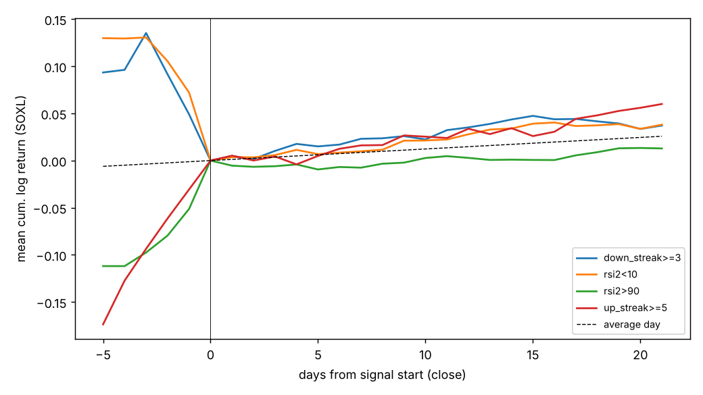
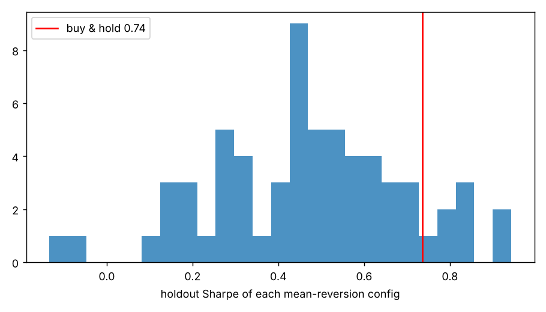

# 底・天井シグナル解析（SOXL）

- 期間 2011-03-09〜2026-10-28、探索/保留の境界 **2022-02-14**
- 約定: シグナル日の引けで判定 → 翌営業日の寄付きで買い。リターンは寄付きから h 日後の引けまでの対数リターン
- 閾値の分位点は探索期間のみから計算。`excess` = シグナル日の平均 − 同期間の全日平均

検定数 410、FDR<5% 1、robust 0

## 底シグナル（5 日先、p 値順 上位 15）

| signal | h | n_disc | episodes_disc | excess_disc | hit_disc | base_hit_disc | t_hac | q_bh | n_hold | excess_hold | hit_hold | base_hit_hold | robust |
|---|---|---|---|---|---|---|---|---|---|---|---|---|---|
| drawdown_252 bottom5% | 5 | 138 | 14 | 0.043 | 0.681 | 0.568 | 2.635 | 0.144 | 383 | 0.005 | 0.561 | 0.537 | False |
| rsi3 bottom5% | 5 | 138 | 78 | 0.020 | 0.587 | 0.568 | 1.782 | 0.383 | 52 | -0.018 | 0.519 | 0.537 | False |
| ret5 bottom5% | 5 | 138 | 58 | 0.031 | 0.659 | 0.568 | 1.670 | 0.414 | 143 | -0.003 | 0.538 | 0.537 | False |
| rsi2<5 | 5 | 129 | 78 | 0.017 | 0.566 | 0.568 | 1.607 | 0.443 | 63 | -0.032 | 0.460 | 0.537 | False |
| drawdown_252 bottom10% | 5 | 276 | 23 | 0.020 | 0.627 | 0.568 | 1.567 | 0.456 | 506 | 0.001 | 0.542 | 0.537 | False |
| dist_sma10 bottom5% | 5 | 138 | 63 | 0.029 | 0.645 | 0.568 | 1.484 | 0.497 | 135 | -0.007 | 0.519 | 0.537 | False |
| rsi14<30 | 5 | 50 | 23 | 0.037 | 0.640 | 0.568 | 1.474 | 0.497 | 7 | 0.027 | 0.571 | 0.537 | False |
| dist_sma50 bottom5% | 5 | 138 | 32 | 0.032 | 0.667 | 0.568 | 1.380 | 0.516 | 186 | 0.015 | 0.548 | 0.537 | False |
| ret5 bottom10% | 5 | 276 | 107 | 0.016 | 0.598 | 0.568 | 1.339 | 0.530 | 216 | 0.009 | 0.588 | 0.537 | False |
| ibs bottom10% | 5 | 276 | 250 | 0.010 | 0.623 | 0.568 | 1.334 | 0.530 | 100 | 0.002 | 0.550 | 0.537 | False |
| ret2 bottom10% | 5 | 276 | 168 | 0.012 | 0.591 | 0.568 | 1.257 | 0.583 | 225 | -0.000 | 0.529 | 0.537 | False |
| dist_sma10 bottom10% | 5 | 276 | 91 | 0.015 | 0.598 | 0.568 | 1.189 | 0.633 | 229 | 0.001 | 0.541 | 0.537 | False |
| ret2 bottom5% | 5 | 138 | 98 | 0.020 | 0.587 | 0.568 | 1.115 | 0.668 | 128 | -0.002 | 0.539 | 0.537 | False |
| logvol_z63 bottom10% | 5 | 276 | 168 | -0.013 | 0.547 | 0.568 | -1.090 | 0.686 | 132 | 0.005 | 0.538 | 0.537 | False |
| dist_sma50 bottom10% | 5 | 276 | 54 | 0.015 | 0.609 | 0.568 | 1.016 | 0.706 | 273 | 0.000 | 0.535 | 0.537 | False |

## 天井シグナル（5 日先、p 値順 上位 15）

| signal | h | n_disc | episodes_disc | excess_disc | hit_disc | base_hit_disc | t_hac | q_bh | n_hold | excess_hold | hit_hold | base_hit_hold | robust |
|---|---|---|---|---|---|---|---|---|---|---|---|---|---|
| rsi14>70 | 5 | 165 | 52 | -0.024 | 0.461 | 0.568 | -2.634 | 0.144 | 96 | 0.000 | 0.531 | 0.537 | False |
| rsi14 top10% | 5 | 276 | 89 | -0.018 | 0.486 | 0.568 | -2.493 | 0.168 | 126 | -0.003 | 0.500 | 0.537 | False |
| ret2 top10% | 5 | 276 | 199 | -0.014 | 0.507 | 0.568 | -2.410 | 0.204 | 240 | -0.007 | 0.533 | 0.537 | False |
| rsi14 top5% | 5 | 138 | 44 | -0.023 | 0.457 | 0.568 | -2.339 | 0.220 | 83 | -0.010 | 0.506 | 0.537 | False |
| bbz20 top10% | 5 | 276 | 118 | -0.014 | 0.482 | 0.568 | -2.080 | 0.319 | 115 | -0.017 | 0.478 | 0.537 | False |
| bbz20 top5% | 5 | 138 | 80 | -0.019 | 0.464 | 0.568 | -2.068 | 0.319 | 66 | -0.025 | 0.424 | 0.537 | False |
| dist_sma50 top5% | 5 | 138 | 39 | -0.025 | 0.420 | 0.568 | -1.992 | 0.333 | 203 | -0.002 | 0.522 | 0.537 | False |
| dist_sma10 top5% | 5 | 138 | 77 | -0.018 | 0.493 | 0.568 | -1.949 | 0.345 | 172 | 0.004 | 0.547 | 0.537 | False |
| ret2 top5% | 5 | 138 | 104 | -0.016 | 0.522 | 0.568 | -1.887 | 0.365 | 153 | -0.006 | 0.549 | 0.537 | False |
| ret5 top5% | 5 | 138 | 77 | -0.018 | 0.500 | 0.568 | -1.833 | 0.383 | 149 | 0.004 | 0.557 | 0.537 | False |
| dist_sma20 top5% | 5 | 138 | 48 | -0.019 | 0.435 | 0.568 | -1.825 | 0.383 | 187 | 0.008 | 0.545 | 0.537 | False |
| dist_sma50 top10% | 5 | 276 | 73 | -0.015 | 0.511 | 0.568 | -1.821 | 0.383 | 253 | -0.002 | 0.522 | 0.537 | False |
| rsi2 top10% | 5 | 276 | 124 | -0.012 | 0.514 | 0.568 | -1.789 | 0.383 | 116 | -0.017 | 0.483 | 0.537 | False |
| rsi2>90 | 5 | 485 | 222 | -0.008 | 0.532 | 0.568 | -1.776 | 0.383 | 186 | -0.017 | 0.495 | 0.537 | False |
| logvol_z63 top5% | 5 | 138 | 109 | -0.014 | 0.486 | 0.568 | -1.721 | 0.401 | 44 | 0.033 | 0.568 | 0.537 | False |

## robust と判定されたもの（全ホライズン）

（なし）

## 21 日の最大含み益/含み損（主要シグナル）

| side | signal | n_disc | mean_disc | mfe21_disc | mae21_disc | n_hold | mean_hold | mfe21_hold | mae21_hold |
|---|---|---|---|---|---|---|---|---|---|
| bottom | down_streak>=2 | 558 | 0.030 | 0.196 | -0.147 | 245 | 0.044 | 0.306 | -0.185 |
| bottom | down_streak>=3 | 240 | 0.046 | 0.210 | -0.148 | 113 | 0.076 | 0.321 | -0.170 |
| bottom | down_streak>=4 | 103 | 0.069 | 0.229 | -0.146 | 49 | 0.113 | 0.322 | -0.169 |
| bottom | rsi2<10 | 276 | 0.035 | 0.201 | -0.155 | 120 | 0.064 | 0.302 | -0.193 |
| bottom | rsi2<5 | 129 | 0.049 | 0.216 | -0.146 | 56 | 0.083 | 0.323 | -0.195 |
| bottom | rsi14<30 | 50 | 0.059 | 0.247 | -0.150 | 6 | 0.226 | 0.434 | -0.228 |
| top | up_streak>=5 | 123 | 0.040 | 0.157 | -0.121 | 54 | 0.206 | 0.481 | -0.163 |
| top | rsi2>90 | 485 | 0.016 | 0.146 | -0.132 | 183 | 0.028 | 0.290 | -0.200 |
| top | rsi14>70 | 165 | -0.011 | 0.121 | -0.142 | 96 | 0.140 | 0.357 | -0.154 |

全日平均（基準）: 探索 平均 0.027 / MFE 0.176 / MAE -0.141、保留 平均 0.021 / MFE 0.285 / MAE -0.203

## 夜間ギャップ分解（超過リターン: 引け→翌寄付き / 翌寄付き→5 日後 / 引け→5 日後）

| side | signal | overnight_disc | open_to_5d_disc | close_to_5d_disc | overnight_hold | open_to_5d_hold | close_to_5d_hold |
|---|---|---|---|---|---|---|---|
| bottom | down_streak>=2 | 0.0006 | 0.0042 | 0.0048 | -0.0000 | 0.0085 | 0.0085 |
| bottom | down_streak>=3 | 0.0022 | 0.0075 | 0.0097 | -0.0029 | 0.0007 | -0.0021 |
| bottom | down_streak>=4 | 0.0024 | 0.0140 | 0.0164 | -0.0070 | -0.0139 | -0.0209 |
| bottom | rsi2<10 | 0.0025 | 0.0028 | 0.0053 | -0.0010 | -0.0162 | -0.0171 |
| bottom | rsi2<5 | 0.0025 | 0.0174 | 0.0198 | -0.0050 | -0.0323 | -0.0372 |
| bottom | ret5 bottom5% | 0.0024 | 0.0311 | 0.0335 | 0.0002 | -0.0030 | -0.0027 |
| bottom | ibs bottom10% | 0.0020 | 0.0098 | 0.0118 | 0.0072 | 0.0017 | 0.0089 |
| top | up_streak>=4 | -0.0008 | -0.0018 | -0.0026 | 0.0034 | 0.0078 | 0.0112 |
| top | rsi2>90 | -0.0005 | -0.0084 | -0.0089 | -0.0013 | -0.0170 | -0.0182 |
| top | rsi14>70 | 0.0009 | -0.0238 | -0.0229 | 0.0008 | 0.0003 | 0.0012 |
| top | bbz20 top5% | 0.0011 | -0.0195 | -0.0184 | -0.0022 | -0.0246 | -0.0267 |

## 底の的中率（シグナル日が前後 10 日安値の ±2 日以内だった割合）と捕捉率

| signal | precision_disc | base_disc | lift_disc | recall_disc | precision_hold | base_hold | lift_hold | recall_hold |
|---|---|---|---|---|---|---|---|---|
| dist_sma10 bottom5% | 0.515 | 0.146 | 3.534 | 0.375 | 0.368 | 0.145 | 2.542 | 0.618 |
| ret5 bottom5% | 0.511 | 0.146 | 3.507 | 0.362 | 0.376 | 0.145 | 2.594 | 0.647 |
| dist_sma10 bottom10% | 0.487 | 0.146 | 3.342 | 0.588 | 0.367 | 0.145 | 2.534 | 0.824 |
| dist_sma20 bottom5% | 0.466 | 0.146 | 3.199 | 0.237 | 0.366 | 0.145 | 2.522 | 0.500 |
| ret10 bottom5% | 0.463 | 0.146 | 3.175 | 0.263 | 0.336 | 0.145 | 2.318 | 0.441 |
| ret5 bottom10% | 0.452 | 0.146 | 3.101 | 0.637 | 0.393 | 0.145 | 2.708 | 0.853 |
| rsi3 bottom5% | 0.449 | 0.146 | 3.078 | 0.438 | 0.404 | 0.145 | 2.787 | 0.441 |
| bbz20 bottom10% | 0.441 | 0.146 | 3.025 | 0.637 | 0.363 | 0.145 | 2.504 | 0.618 |
| rsi14<30 | 0.440 | 0.146 | 3.019 | 0.113 | 0.429 | 0.145 | 2.957 | 0.029 |
| rsi2<5 | 0.433 | 0.146 | 2.972 | 0.412 | 0.302 | 0.145 | 2.081 | 0.412 |
| vix_vs_sma20 bottom5% | 0.431 | 0.146 | 2.955 | 0.325 | 0.469 | 0.145 | 3.234 | 0.176 |
| ret10 bottom10% | 0.420 | 0.146 | 2.883 | 0.475 | 0.330 | 0.145 | 2.279 | 0.676 |
| down_streak>=5 | 0.415 | 0.146 | 2.845 | 0.150 | 0.346 | 0.145 | 2.388 | 0.235 |
| vix_vs_sma20 bottom10% | 0.414 | 0.146 | 2.841 | 0.512 | 0.404 | 0.145 | 2.789 | 0.412 |
| rsi14 bottom5% | 0.409 | 0.146 | 2.805 | 0.300 | 0.435 | 0.145 | 3.005 | 0.353 |
## 実際のスイング底/天井（前後 10 日の極値）の判別力 AUC（0.5 = 無情報、底の基準率 0.029）

| indicator | auc_bottom_disc | auc_bottom_hold | auc_top_disc | auc_top_hold |
|---|---|---|---|---|
| rsi3 | 0.941 | 0.928 | 0.888 | 0.907 |
| rsi2 | 0.929 | 0.914 | 0.884 | 0.899 |
| dist_sma10 | 0.921 | 0.904 | 0.848 | 0.868 |
| bbz20 | 0.909 | 0.880 | 0.849 | 0.868 |
| ret5 | 0.902 | 0.905 | 0.792 | 0.831 |
| ret2 | 0.888 | 0.849 | 0.785 | 0.762 |
| dist_sma20 | 0.881 | 0.859 | 0.802 | 0.834 |
| rsi14 | 0.879 | 0.844 | 0.797 | 0.800 |
| ret1 | 0.868 | 0.854 | 0.757 | 0.728 |
| ret10 | 0.868 | 0.839 | 0.786 | 0.816 |
| down_streak | 0.867 | 0.860 | 0.735 | 0.738 |
| vix_vs_sma20 | 0.825 | 0.764 | 0.676 | 0.653 |
| dist_sma50 | 0.783 | 0.732 | 0.720 | 0.715 |
| up_streak | 0.780 | 0.772 | 0.816 | 0.823 |
| ibs | 0.772 | 0.753 | 0.725 | 0.668 |
| breadth_sma50 | 0.762 | 0.728 | 0.684 | 0.659 |
| vix_term | 0.747 | 0.701 | 0.633 | 0.635 |
| logvol_z63 | 0.706 | 0.732 | 0.503 | 0.567 |
| drawdown_252 | 0.673 | 0.595 | 0.669 | 0.653 |

## トレンド別の底シグナル（5 日先）

| signal | trend | period | n | mean_fwd5 | excess_fwd5 | hit |
|---|---|---|---|---|---|---|
| down_streak>=2 | SOX>SMA200 | disc | 400 | 0.008 | 0.004 | 0.568 |
| down_streak>=2 | SOX>SMA200 | hold | 151 | 0.018 | 0.015 | 0.576 |
| down_streak>=2 | SOX<SMA200 | disc | 158 | 0.012 | 0.005 | 0.620 |
| down_streak>=2 | SOX<SMA200 | hold | 102 | 0.001 | -0.000 | 0.549 |
| down_streak>=3 | SOX>SMA200 | disc | 155 | 0.010 | 0.006 | 0.555 |
| down_streak>=3 | SOX>SMA200 | hold | 66 | 0.009 | 0.006 | 0.591 |
| down_streak>=3 | SOX<SMA200 | disc | 85 | 0.017 | 0.010 | 0.600 |
| down_streak>=3 | SOX<SMA200 | hold | 54 | -0.004 | -0.005 | 0.556 |
| rsi2<10 | SOX>SMA200 | disc | 174 | 0.002 | -0.003 | 0.534 |
| rsi2<10 | SOX>SMA200 | hold | 70 | 0.004 | 0.000 | 0.571 |
| rsi2<10 | SOX<SMA200 | disc | 102 | 0.018 | 0.011 | 0.618 |
| rsi2<10 | SOX<SMA200 | hold | 57 | -0.035 | -0.036 | 0.491 |
| rsi2<5 | SOX>SMA200 | disc | 71 | 0.010 | 0.006 | 0.521 |
| rsi2<5 | SOX>SMA200 | hold | 33 | -0.019 | -0.022 | 0.424 |
| rsi2<5 | SOX<SMA200 | disc | 58 | 0.037 | 0.031 | 0.621 |
| rsi2<5 | SOX<SMA200 | hold | 30 | -0.042 | -0.043 | 0.500 |
| ibs bottom10% | SOX>SMA200 | disc | 185 | 0.011 | 0.006 | 0.600 |
| ibs bottom10% | SOX>SMA200 | hold | 69 | 0.015 | 0.011 | 0.594 |
| ibs bottom10% | SOX<SMA200 | disc | 91 | 0.023 | 0.016 | 0.670 |
| ibs bottom10% | SOX<SMA200 | hold | 31 | -0.019 | -0.020 | 0.452 |
| bbz20 bottom5% | SOX>SMA200 | disc | 84 | -0.001 | -0.005 | 0.500 |
| bbz20 bottom5% | SOX>SMA200 | hold | 24 | 0.025 | 0.022 | 0.583 |
| bbz20 bottom5% | SOX<SMA200 | disc | 54 | 0.005 | -0.001 | 0.593 |
| bbz20 bottom5% | SOX<SMA200 | hold | 29 | -0.037 | -0.038 | 0.448 |

## 逆張り売買ルール（64 通り、片道 5.0bp）

保留期間で買い持ちの Sharpe を上回った設定の割合: **12%**

探索期間 Sharpe 上位 5 設定と買い持ち

| rule | period | CAGR | vol | sharpe | maxDD | exposure | trades_per_year | win_rate | avg_trade |
|---|---|---|---|---|---|---|---|---|---|
| buy_hold | disc | 0.416 | 0.804 | 0.835 | -0.804 | 1.000 | 0.000 |  |  |
| buy_hold | hold | 0.246 | 1.158 | 0.735 | -0.879 | 1.000 | 0.000 |  |  |
| down>=4 & none -> time5d | disc | 0.210 | 0.298 | 0.771 | -0.431 | 0.111 | 5.584 | 0.590 | 0.042 |
| down>=4 & none -> time5d | hold | 0.011 | 0.428 | 0.151 | -0.577 | 0.123 | 6.188 | 0.517 | 0.009 |
| ibs<0.15 & none -> rsi2>70|10d | disc | 0.342 | 0.587 | 0.792 | -0.723 | 0.369 | 23.983 | 0.698 | 0.018 |
| ibs<0.15 & none -> rsi2>70|10d | hold | 0.457 | 0.725 | 0.813 | -0.479 | 0.342 | 22.191 | 0.654 | 0.024 |
| ibs<0.15 & none -> close>sma5|10d | disc | 0.279 | 0.541 | 0.724 | -0.649 | 0.315 | 26.729 | 0.668 | 0.013 |
| ibs<0.15 & none -> close>sma5|10d | hold | 0.386 | 0.683 | 0.746 | -0.609 | 0.289 | 24.539 | 0.652 | 0.017 |
| ibs<0.15 & none -> time5d | disc | 0.491 | 0.595 | 0.966 | -0.663 | 0.444 | 22.426 | 0.596 | 0.025 |
| ibs<0.15 & none -> time5d | hold | 0.157 | 0.802 | 0.527 | -0.779 | 0.428 | 21.551 | 0.535 | 0.012 |
| ibs<0.15 & SOX>SMA200 -> time5d | disc | 0.256 | 0.449 | 0.725 | -0.634 | 0.327 | 16.477 | 0.594 | 0.019 |
| ibs<0.15 & SOX>SMA200 -> time5d | hold | 0.132 | 0.614 | 0.447 | -0.713 | 0.296 | 14.936 | 0.557 | 0.012 |

保留期間の Sharpe 90% 区間と対買い持ち差（ブロック・ブートストラップ）

| rule | sharpe_lo | sharpe_hi | diff_lo | diff_hi | p_diff_le0 |
|---|---|---|---|---|---|
| down>=4 & none -> time5d | -0.513 | 0.805 | -1.433 | 0.263 | 0.865 |
| ibs<0.15 & none -> rsi2>70|10d | 0.258 | 1.419 | -0.572 | 0.696 | 0.409 |
| ibs<0.15 & none -> close>sma5|10d | 0.184 | 1.368 | -0.614 | 0.623 | 0.480 |
| ibs<0.15 & none -> time5d | -0.063 | 1.162 | -0.721 | 0.281 | 0.742 |
| ibs<0.15 & SOX>SMA200 -> time5d | -0.239 | 1.122 | -0.864 | 0.297 | 0.781 |

全設定は `strategies.csv`。