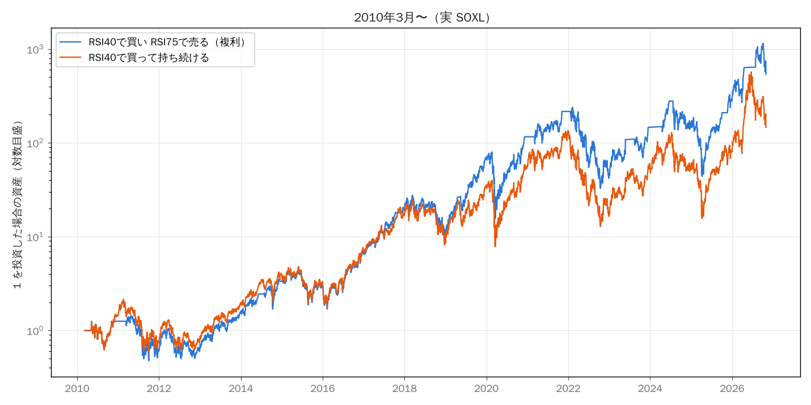

# RSI40 で買い RSI75 で売る（複利） vs RSI40 で買って持ち続ける

- 判断は引け、売買は翌営業日の引け。待機中の現金は短期金利。手数料・税は含めない

## 2010 年 3 月から

| 方法 | 最終倍率 | CAGR | vol | sharpe | sortino | maxDD | calmar | years | 投資している日の割合 | 売買回数 |
|---|---|---|---|---|---|---|---|---|---|---|
| RSI40で買い RSI75で売る（複利） | 537.813 | 0.460 | 0.834 | 0.856 | 1.101 | -0.864 | 0.533 | 16.615 | 0.849 | 15 |
| RSI40で買って持ち続ける | 146.454 | 0.350 | 0.917 | 0.774 | 1.069 | -0.905 | 0.387 | 16.615 | 0.990 | 1 |

## 開始年ごと（終点は直近）

| 開始年 | RSI40で買い RSI75で売る（複利）_倍率 | RSI40で買って持ち続ける_倍率 | 勝ち |
|---|---|---|---|
| 2010 | 537.813 | 146.454 | 売買 |
| 2011 | 428.288 | 94.322 | 売買 |
| 2012 | 626.480 | 137.970 | 売買 |
| 2013 | 664.974 | 146.448 | 売買 |
| 2014 | 219.393 | 49.775 | 売買 |
| 2015 | 160.405 | 41.624 | 売買 |
| 2016 | 236.832 | 61.456 | 売買 |
| 2017 | 70.127 | 18.197 | 売買 |
| 2018 | 26.016 | 8.091 | 売買 |
| 2019 | 48.670 | 15.136 | 売買 |
| 2020 | 8.693 | 4.730 | 売買 |
| 2021 | 4.630 | 2.428 | 売買 |
| 2022 | 2.488 | 1.728 | 売買 |
| 2023 | 8.598 | 5.970 | 売買 |
| 2024 | 3.663 | 2.274 | 売買 |

## 売る RSI の水準（2010 年開始）

| 売るRSI | 最終倍率 | CAGR | vol | sharpe | sortino | maxDD | calmar | years |
|---|---|---|---|---|---|---|---|---|
| 65 | 46.765 | 0.260 | 0.721 | 0.663 | 0.661 | -0.804 | 0.324 | 16.615 |
| 70 | 279.585 | 0.404 | 0.777 | 0.808 | 0.911 | -0.864 | 0.467 | 16.615 |
| 75 | 537.813 | 0.460 | 0.834 | 0.856 | 1.101 | -0.864 | 0.533 | 16.615 |
| 80 | 537.157 | 0.460 | 0.860 | 0.856 | 1.150 | -0.879 | 0.523 | 16.615 |
| 85 | 238.185 | 0.390 | 0.884 | 0.802 | 1.101 | -0.905 | 0.431 | 16.615 |

