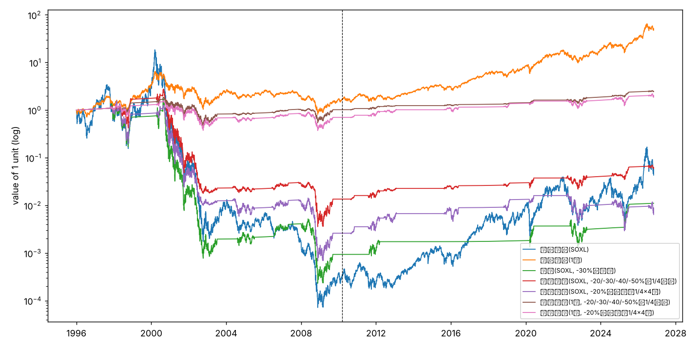

# 分割買いの検証

- 期間 1996-01-02〜2026-10-30（2010-03 以前の SOXL は合成）
- ^SOX の 52 週高値からの下落率で買い、高値の -5% 以内に戻ったら翌日に全て売る。待機中の現金は短期金利で運用
- 判断は引け、約定は翌営業日の引け。売買コストは含めていない（回数が少ないため影響は小さい）

## 全体成績

| plan | period | CAGR | vol | sharpe | maxDD | exposure |
|---|---|---|---|---|---|---|
| 買い持ち(SOXL) | 全期間 | -0.097 | 1.137 | 0.459 | -1.000 | 1.000 |
| 買い持ち(SOXL) | 合成期(〜2010-03) | -0.431 | 1.347 | 0.227 | -1.000 | 1.000 |
| 買い持ち(SOXL) | 実SOXL期(2010-03〜) | 0.339 | 0.921 | 0.766 | -0.905 | 1.000 |
| 買い持ち(1倍) | 全期間 | 0.134 | 0.382 | 0.458 | -0.875 | 1.000 |
| 買い持ち(1倍) | 合成期(〜2010-03) | 0.037 | 0.449 | 0.232 | -0.875 | 1.000 |
| 買い持ち(1倍) | 実SOXL期(2010-03〜) | 0.223 | 0.314 | 0.750 | -0.466 | 1.000 |
| 一括(SOXL, -30%で全額) | 全期間 | -0.136 | 0.791 | 0.176 | -1.000 | 0.298 |
| 一括(SOXL, -30%で全額) | 合成期(〜2010-03) | -0.389 | 1.070 | 0.040 | -1.000 | 0.512 |
| 一括(SOXL, -30%で全額) | 実SOXL期(2010-03〜) | 0.160 | 0.427 | 0.519 | -0.734 | 0.115 |
| 価格分割(SOXL, -20/-30/-40/-50%で1/4ずつ) | 全期間 | -0.088 | 0.580 | 0.088 | -0.999 | 0.215 |
| 価格分割(SOXL, -20/-30/-40/-50%で1/4ずつ) | 合成期(〜2010-03) | -0.262 | 0.813 | -0.014 | -0.999 | 0.333 |
| 価格分割(SOXL, -20/-30/-40/-50%で1/4ずつ) | 実SOXL期(2010-03〜) | 0.093 | 0.246 | 0.423 | -0.478 | 0.115 |
| 時間分割(SOXL, -20%から毎月1/4×4回) | 全期間 | -0.151 | 0.687 | 0.069 | -1.000 | 0.331 |
| 時間分割(SOXL, -20%から毎月1/4×4回) | 合成期(〜2010-03) | -0.343 | 0.874 | -0.084 | -1.000 | 0.439 |
| 時間分割(SOXL, -20%から毎月1/4×4回) | 実SOXL期(2010-03〜) | 0.056 | 0.472 | 0.318 | -0.837 | 0.240 |
| 価格分割(1倍, -20/-30/-40/-50%で1/4ずつ) | 全期間 | 0.029 | 0.232 | 0.140 | -0.759 | 0.251 |
| 価格分割(1倍, -20/-30/-40/-50%で1/4ずつ) | 合成期(〜2010-03) | 0.001 | 0.327 | 0.067 | -0.759 | 0.409 |
| 価格分割(1倍, -20/-30/-40/-50%で1/4ずつ) | 実SOXL期(2010-03〜) | 0.054 | 0.090 | 0.460 | -0.186 | 0.116 |
| 時間分割(1倍, -20%から毎月1/4×4回) | 全期間 | 0.021 | 0.263 | 0.120 | -0.764 | 0.365 |
| 時間分割(1倍, -20%から毎月1/4×4回) | 合成期(〜2010-03) | -0.025 | 0.347 | 0.006 | -0.764 | 0.512 |
| 時間分割(1倍, -20%から毎月1/4×4回) | 実SOXL期(2010-03〜) | 0.061 | 0.162 | 0.352 | -0.347 | 0.240 |

## 局面ごとの成績（買い始め → 回復して売るまで、資金全体に対するリターン）

| plan | n | win_rate | median | mean | worst_episode | worst_interim | median_days |
|---|---|---|---|---|---|---|---|
| 一括(SOXL, -30%で全額) | 10 | 0.600 | 0.178 | 0.277 | -0.998 | -0.999 | 306.500 |
| 価格分割(SOXL, -20/-30/-40/-50%で1/4ずつ) | 14 | 0.786 | 0.134 | 0.070 | -0.989 | -0.991 | 302.500 |
| 時間分割(SOXL, -20%から毎月1/4×4回) | 14 | 0.571 | 0.208 | -0.012 | -0.988 | -0.991 | 302.500 |
| 価格分割(1倍, -20/-30/-40/-50%で1/4ずつ) | 14 | 0.857 | 0.080 | 0.058 | -0.507 | -0.731 | 302.500 |
| 時間分割(1倍, -20%から毎月1/4×4回) | 14 | 0.786 | 0.116 | 0.047 | -0.539 | -0.748 | 302.500 |

## 一括 vs 時間分割（毎月 1/4 × 4 回）: 任意の月に始めた場合の 1・2 年後

lump = 一括、slices = 分割。median = 中央値、p10 = 悪い方から 10% の値、loss_prob = 損失確率、big_loss_prob = 半分以上失う確率

| start_condition | years | method | n_starts | median | p10 | worst | loss_prob | big_loss_prob |
|---|---|---|---|---|---|---|---|---|
| 全ての月 | 1 | lump_soxl | 357 | 0.156 | -0.857 | -0.988 | 0.448 | 0.241 |
| 全ての月 | 1 | slices_soxl | 357 | 0.217 | -0.804 | -0.984 | 0.437 | 0.207 |
| 全ての月 | 1 | lump_onex | 357 | 0.179 | -0.296 | -0.568 | 0.342 | 0.020 |
| 全ての月 | 1 | slices_onex | 357 | 0.173 | -0.282 | -0.575 | 0.328 | 0.006 |
| 全ての月 | 1 | 分割が一括に勝った割合(soxl) | 357 | 0.479 |  |  |  |  |
| 全ての月 | 1 | 分割が一括に勝った割合(onex) | 357 | 0.409 |  |  |  |  |
| 全ての月 | 2 | lump_soxl | 345 | -0.004 | -0.926 | -0.999 | 0.501 | 0.275 |
| 全ての月 | 2 | slices_soxl | 345 | 0.058 | -0.901 | -0.997 | 0.475 | 0.270 |
| 全ての月 | 2 | lump_onex | 345 | 0.281 | -0.312 | -0.739 | 0.243 | 0.041 |
| 全ての月 | 2 | slices_onex | 345 | 0.257 | -0.298 | -0.679 | 0.246 | 0.041 |
| 全ての月 | 2 | 分割が一括に勝った割合(soxl) | 345 | 0.481 |  |  |  |  |
| 全ての月 | 2 | 分割が一括に勝った割合(onex) | 345 | 0.412 |  |  |  |  |
| SOX が高値から-20%以上下落中に開始 | 1 | lump_soxl | 107 | 0.321 | -0.912 | -0.980 | 0.411 | 0.308 |
| SOX が高値から-20%以上下落中に開始 | 1 | slices_soxl | 107 | 0.434 | -0.902 | -0.959 | 0.383 | 0.262 |
| SOX が高値から-20%以上下落中に開始 | 1 | lump_onex | 107 | 0.236 | -0.367 | -0.521 | 0.290 | 0.037 |
| SOX が高値から-20%以上下落中に開始 | 1 | slices_onex | 107 | 0.225 | -0.393 | -0.506 | 0.299 | 0.009 |
| SOX が高値から-20%以上下落中に開始 | 1 | 分割が一括に勝った割合(soxl) | 107 | 0.533 |  |  |  |  |
| SOX が高値から-20%以上下落中に開始 | 1 | 分割が一括に勝った割合(onex) | 107 | 0.458 |  |  |  |  |
| SOX が高値から-20%以上下落中に開始 | 2 | lump_soxl | 104 | -0.058 | -0.973 | -0.999 | 0.519 | 0.308 |
| SOX が高値から-20%以上下落中に開始 | 2 | slices_soxl | 104 | 0.058 | -0.943 | -0.997 | 0.462 | 0.298 |
| SOX が高値から-20%以上下落中に開始 | 2 | lump_onex | 104 | 0.300 | -0.388 | -0.739 | 0.260 | 0.058 |
| SOX が高値から-20%以上下落中に開始 | 2 | slices_onex | 104 | 0.315 | -0.302 | -0.679 | 0.260 | 0.048 |
| SOX が高値から-20%以上下落中に開始 | 2 | 分割が一括に勝った割合(soxl) | 104 | 0.538 |  |  |  |  |
| SOX が高値から-20%以上下落中に開始 | 2 | 分割が一括に勝った割合(onex) | 104 | 0.462 |  |  |  |  |

### 一括(SOXL, -30%で全額)

| start | start_dd | min_dd | deployed | end | days | return | worst | open |
|---|---|---|---|---|---|---|---|---|
| 1997-11-12 | -0.311 | -0.513 | 1.000 | 1998-11-24 | 377 | -0.354 | -0.845 | False |
| 2000-04-14 | -0.331 | -0.347 | 1.000 | 2000-06-22 | 69 | 0.275 | -0.463 | False |
| 2000-08-04 | -0.309 | -0.664 | 1.000 | 2003-07-08 | 1068 | -0.998 | -0.999 | False |
| 2004-08-06 | -0.310 | -0.372 | 1.000 | 2005-07-07 | 335 | 0.081 | -0.276 | False |
| 2006-07-21 | -0.301 | -0.301 | 1.000 | 2007-04-26 | 279 | 0.787 | 0.000 | False |
| 2008-01-04 | -0.318 | -0.604 | 1.000 | 2009-09-10 | 615 | -0.773 | -0.944 | False |
| 2011-08-19 | -0.310 | -0.310 | 1.000 | 2012-03-14 | 208 | 0.849 | -0.071 | False |
| 2020-03-16 | -0.344 | -0.350 | 1.000 | 2020-06-03 | 79 | 1.011 | -0.271 | False |
| 2022-05-11 | -0.304 | -0.465 | 1.000 | 2023-04-10 | 334 | -0.147 | -0.641 | False |
| 2025-04-03 | -0.341 | -0.397 | 1.000 | 2025-07-03 | 91 | 2.037 | -0.055 | False |

### 価格分割(SOXL, -20/-30/-40/-50%で1/4ずつ)

| start | start_dd | min_dd | deployed | end | days | return | worst | open |
|---|---|---|---|---|---|---|---|---|
| 1997-10-24 | -0.219 | -0.513 | 1.000 | 1998-11-24 | 396.000 | 0.538 | -0.616 | False |
| 2000-04-12 | -0.221 | -0.347 | 0.500 | 2000-06-22 | 71.000 | 0.114 | -0.241 | False |
| 2000-07-26 | -0.224 | -0.664 | 1.000 | 2003-07-08 | 1077.000 | -0.989 | -0.991 | False |
| 2004-04-30 | -0.209 | -0.372 | 0.500 | 2005-07-07 | 433.000 | -0.050 | -0.205 | False |
| 2006-06-12 | -0.209 | -0.301 | 0.500 | 2007-04-26 | 318.000 | 0.283 | -0.080 | False |
| 2007-11-09 | -0.202 | -0.604 | 1.000 | 2009-09-10 | 671.000 | -0.551 | -0.882 | False |
| 2010-08-24 | -0.206 | -0.233 | 0.250 | 2010-11-05 | 73.000 | 0.188 | -0.033 | False |
| 2011-08-02 | -0.207 | -0.310 | 0.500 | 2012-03-14 | 225.000 | 0.249 | -0.124 | False |
| 2012-06-01 | -0.201 | -0.205 | 0.250 | 2013-02-04 | 248.000 | 0.127 | -0.008 | False |
| 2015-08-20 | -0.203 | -0.251 | 0.250 | 2016-06-02 | 287.000 | 0.141 | -0.048 | False |
| 2018-10-24 | -0.207 | -0.260 | 0.250 | 2019-02-26 | 125.000 | 0.106 | -0.069 | False |
| 2020-03-09 | -0.213 | -0.350 | 0.500 | 2020-06-03 | 86.000 | 0.253 | -0.227 | False |
| 2022-03-07 | -0.233 | -0.465 | 0.750 | 2023-04-10 | 399.000 | 0.038 | -0.418 | False |
| 2024-08-02 | -0.220 | -0.397 | 0.500 | 2025-07-03 | 335.000 | 0.527 | -0.167 | False |
| 2026-07-17 | -0.202 | -0.286 | 0.250 | NaT |  | -0.100 | -0.100 | True |

### 時間分割(SOXL, -20%から毎月1/4×4回)

| start | start_dd | min_dd | deployed | end | days | return | worst | open |
|---|---|---|---|---|---|---|---|---|
| 1997-10-24 | -0.219 | -0.513 | 1.000 | 1998-11-24 | 396.000 | -0.256 | -0.816 | False |
| 2000-04-12 | -0.221 | -0.347 | 0.750 | 2000-06-22 | 71.000 | 0.218 | -0.220 | False |
| 2000-07-26 | -0.224 | -0.664 | 1.000 | 2003-07-08 | 1077.000 | -0.988 | -0.991 | False |
| 2004-04-30 | -0.209 | -0.372 | 1.000 | 2005-07-07 | 433.000 | -0.301 | -0.532 | False |
| 2006-06-12 | -0.209 | -0.301 | 1.000 | 2007-04-26 | 318.000 | 0.389 | -0.128 | False |
| 2007-11-09 | -0.202 | -0.604 | 1.000 | 2009-09-10 | 671.000 | -0.800 | -0.948 | False |
| 2010-08-24 | -0.206 | -0.233 | 0.750 | 2010-11-05 | 73.000 | 0.367 | -0.033 | False |
| 2011-08-02 | -0.207 | -0.310 | 1.000 | 2012-03-14 | 225.000 | 0.518 | -0.180 | False |
| 2012-06-01 | -0.201 | -0.205 | 1.000 | 2013-02-04 | 248.000 | 0.243 | -0.198 | False |
| 2015-08-20 | -0.203 | -0.251 | 1.000 | 2016-06-02 | 287.000 | 0.329 | -0.315 | False |
| 2018-10-24 | -0.207 | -0.260 | 1.000 | 2019-02-26 | 125.000 | 0.433 | -0.160 | False |
| 2020-03-09 | -0.213 | -0.350 | 0.750 | 2020-06-03 | 86.000 | 0.197 | -0.159 | False |
| 2022-03-07 | -0.233 | -0.465 | 1.000 | 2023-04-10 | 399.000 | -0.385 | -0.741 | False |
| 2024-08-02 | -0.220 | -0.397 | 1.000 | 2025-07-03 | 335.000 | -0.128 | -0.724 | False |
| 2026-07-17 | -0.202 | -0.286 | 1.000 | NaT |  | -0.331 | -0.331 | True |

### 価格分割(1倍, -20/-30/-40/-50%で1/4ずつ)

| start | start_dd | min_dd | deployed | end | days | return | worst | open |
|---|---|---|---|---|---|---|---|---|
| 1997-10-24 | -0.219 | -0.513 | 1.000 | 1998-11-24 | 396.000 | 0.286 | -0.215 | False |
| 2000-04-12 | -0.221 | -0.347 | 0.500 | 2000-06-22 | 71.000 | 0.105 | -0.066 | False |
| 2000-07-26 | -0.224 | -0.664 | 1.000 | 2003-07-08 | 1077.000 | -0.507 | -0.731 | False |
| 2004-04-30 | -0.209 | -0.372 | 0.500 | 2005-07-07 | 433.000 | 0.035 | -0.071 | False |
| 2006-06-12 | -0.209 | -0.301 | 0.500 | 2007-04-26 | 318.000 | 0.137 | -0.024 | False |
| 2007-11-09 | -0.202 | -0.604 | 1.000 | 2009-09-10 | 671.000 | -0.019 | -0.478 | False |
| 2010-08-24 | -0.206 | -0.233 | 0.250 | 2010-11-05 | 73.000 | 0.055 | -0.011 | False |
| 2011-08-02 | -0.207 | -0.310 | 0.500 | 2012-03-14 | 225.000 | 0.104 | -0.037 | False |
| 2012-06-01 | -0.201 | -0.205 | 0.250 | 2013-02-04 | 248.000 | 0.043 | -0.001 | False |
| 2015-08-20 | -0.203 | -0.251 | 0.250 | 2016-06-02 | 287.000 | 0.054 | -0.008 | False |
| 2018-10-24 | -0.207 | -0.260 | 0.250 | 2019-02-26 | 125.000 | 0.047 | -0.019 | False |
| 2020-03-09 | -0.213 | -0.350 | 0.500 | 2020-06-03 | 86.000 | 0.132 | -0.080 | False |
| 2022-03-07 | -0.233 | -0.465 | 0.750 | 2023-04-10 | 399.000 | 0.112 | -0.155 | False |
| 2024-08-02 | -0.220 | -0.397 | 0.500 | 2025-07-03 | 335.000 | 0.231 | -0.033 | False |
| 2026-07-17 | -0.202 | -0.286 | 0.250 | NaT |  | -0.014 | -0.027 | True |

### 時間分割(1倍, -20%から毎月1/4×4回)

| start | start_dd | min_dd | deployed | end | days | return | worst | open |
|---|---|---|---|---|---|---|---|---|
| 1997-10-24 | -0.219 | -0.513 | 1.000 | 1998-11-24 | 396.000 | 0.121 | -0.319 | False |
| 2000-04-12 | -0.221 | -0.347 | 0.750 | 2000-06-22 | 71.000 | 0.126 | -0.065 | False |
| 2000-07-26 | -0.224 | -0.664 | 1.000 | 2003-07-08 | 1077.000 | -0.539 | -0.748 | False |
| 2004-04-30 | -0.209 | -0.372 | 1.000 | 2005-07-07 | 433.000 | -0.026 | -0.203 | False |
| 2006-06-12 | -0.209 | -0.301 | 1.000 | 2007-04-26 | 318.000 | 0.188 | -0.040 | False |
| 2007-11-09 | -0.202 | -0.604 | 1.000 | 2009-09-10 | 671.000 | -0.173 | -0.562 | False |
| 2010-08-24 | -0.206 | -0.233 | 0.750 | 2010-11-05 | 73.000 | 0.109 | -0.011 | False |
| 2011-08-02 | -0.207 | -0.310 | 1.000 | 2012-03-14 | 225.000 | 0.196 | -0.052 | False |
| 2012-06-01 | -0.201 | -0.205 | 1.000 | 2013-02-04 | 248.000 | 0.090 | -0.063 | False |
| 2015-08-20 | -0.203 | -0.251 | 1.000 | 2016-06-02 | 287.000 | 0.131 | -0.100 | False |
| 2018-10-24 | -0.207 | -0.260 | 1.000 | 2019-02-26 | 125.000 | 0.154 | -0.047 | False |
| 2020-03-09 | -0.213 | -0.350 | 0.750 | 2020-06-03 | 86.000 | 0.110 | -0.056 | False |
| 2022-03-07 | -0.233 | -0.465 | 1.000 | 2023-04-10 | 399.000 | 0.005 | -0.304 | False |
| 2024-08-02 | -0.220 | -0.397 | 1.000 | 2025-07-03 | 335.000 | 0.169 | -0.259 | False |
| 2026-07-17 | -0.202 | -0.286 | 1.000 | NaT |  | -0.075 | -0.075 | True |

