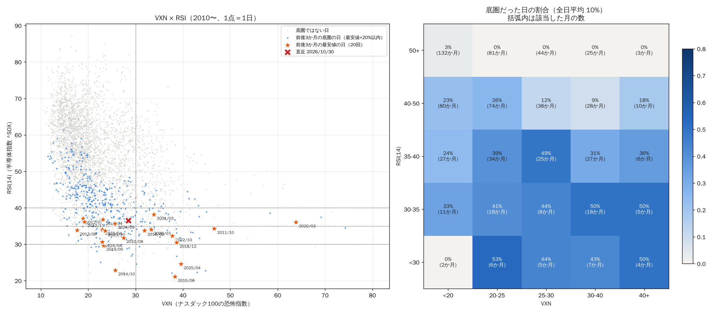

# VXN × RSI（2010 年〜、実 SOXL）

## 前後 3 か月の最安値の日

| Date | price | rsi14 | vxn | vix | dist_sma50 | fwd_6m | fwd_1y |
|---|---|---|---|---|---|---|---|
| 2010-08-31 | 0.327 | 31.798 | 27.450 | 26.050 | -10.509 | 3.055 | 1.296 |
| 2011-10-03 | 0.310 | 34.281 | 46.610 | 45.450 | -9.022 | 2.051 | 1.331 |
| 2012-07-17 | 0.326 | 37.074 | 18.910 | 16.480 | -5.944 | 1.544 | 2.436 |
| 2012-11-15 | 0.327 | 36.196 | 19.230 | 17.990 | -6.328 | 2.210 | 2.741 |
| 2013-08-27 | 0.634 | 33.864 | 17.630 | 16.770 | -4.584 | 1.919 | 2.728 |
| 2014-10-13 | 1.068 | 22.907 | 25.720 | 24.640 | -12.641 | 2.040 | 1.282 |
| 2015-08-25 | 1.037 | 21.124 | 38.320 | 36.020 | -15.004 | 1.224 | 2.445 |
| 2016-02-11 | 0.935 | 33.790 | 31.870 | 28.140 | -11.219 | 2.530 | 4.618 |
| 2018-04-25 | 7.725 | 36.753 | 23.070 | 17.840 | -7.494 | 0.906 | 1.537 |
| 2018-12-24 | 4.285 | 30.475 | 38.680 | 36.070 | -10.948 | 2.123 | 4.229 |
| 2019-05-31 | 6.808 | 29.677 | 23.230 | 18.710 | -10.888 | 2.166 | 1.444 |
| 2020-03-20 | 4.125 | 36.055 | 63.850 | 66.040 | -26.825 | 3.543 | 8.694 |
| 2021-03-08 | 26.671 | 38.183 | 33.870 | 25.470 | -7.690 | 1.717 | 1.076 |
| 2022-10-14 | 6.753 | 32.269 | 37.750 | 32.020 | -18.120 | 2.289 | 2.808 |
| 2023-04-25 | 12.927 | 34.046 | 22.970 | 18.760 | -4.668 | 1.295 | 2.852 |
| 2023-10-30 | 14.276 | 33.660 | 23.610 | 19.750 | -8.057 | 2.373 | 2.359 |
| 2024-04-19 | 30.344 | 30.684 | 22.950 | 18.710 | -9.371 | 1.151 | 0.338 |
| 2024-09-06 | 25.656 | 35.716 | 25.640 | 22.380 | -12.534 | 0.674 | 1.114 |
| 2025-04-08 | 8.216 | 24.575 | 39.560 | 52.330 | -24.006 | 5.203 | 9.291 |
| 2026-03-30 | 40.593 | 34.037 | 33.260 | 30.610 | -10.160 | 3.621 |  |

## 底圏だった割合

| rsi14 | <20 | 20-25 | 25-30 | 30-40 | 40+ |
|---|---|---|---|---|---|
| <30 | 0.00 | 0.53 | 0.44 | 0.43 | 0.50 |
| 30-35 | 0.33 | 0.41 | 0.44 | 0.50 | 0.50 |
| 35-40 | 0.24 | 0.39 | 0.49 | 0.31 | 0.36 |
| 40-50 | 0.23 | 0.26 | 0.12 | 0.09 | 0.18 |
| 50+ | 0.03 | 0.00 | 0.00 | 0.00 | 0.00 |

## 該当した月数

| rsi14 | <20 | 20-25 | 25-30 | 30-40 | 40+ |
|---|---|---|---|---|---|
| <30 | 2 | 6 | 5 | 7 | 4 |
| 30-35 | 11 | 18 | 8 | 18 | 5 |
| 35-40 | 27 | 34 | 25 | 27 | 6 |
| 40-50 | 80 | 74 | 38 | 28 | 10 |
| 50+ | 132 | 81 | 44 | 25 | 3 |

## 6か月後の倍率（中央値）

| rsi14 | <20 | 20-25 | 25-30 | 30-40 | 40+ |
|---|---|---|---|---|---|
| <30 | 0.79 | 0.99 | 1.54 | 2.00 | 1.55 |
| 30-35 | 0.92 | 1.16 | 1.71 | 1.35 | 1.85 |
| 35-40 | 1.29 | 0.93 | 1.58 | 1.33 | 1.63 |
| 40-50 | 1.27 | 1.14 | 1.44 | 1.31 | 2.11 |
| 50+ | 1.23 | 1.28 | 1.36 | 1.90 | 2.50 |

## 1年後プラスの割合

| rsi14 | <20 | 20-25 | 25-30 | 30-40 | 40+ |
|---|---|---|---|---|---|
| <30 | 0.50 | 0.73 | 1.00 | 0.86 | 1.00 |
| 30-35 | 0.67 | 0.87 | 0.72 | 0.68 | 1.00 |
| 35-40 | 0.74 | 0.61 | 0.62 | 0.81 | 0.79 |
| 40-50 | 0.70 | 0.68 | 0.73 | 0.68 | 0.95 |
| 50+ | 0.66 | 0.52 | 0.81 | 0.75 | 1.00 |

## 底圏だった割合（2010-2017）

| rsi14 | <20 | 20-25 | 25-30 | 30-40 | 40+ |
|---|---|---|---|---|---|
| <30 | 0.00 | 0.30 | 0.58 | 0.60 | 1.00 |
| 30-35 | 0.30 | 0.12 | 0.70 | 0.83 | 0.67 |
| 35-40 | 0.25 | 0.38 | 0.52 | 0.40 | 0.50 |
| 40-50 | 0.25 | 0.31 | 0.16 | 0.07 | 0.20 |
| 50+ | 0.04 | 0.00 | 0.00 | 0.00 |  |

## 底圏だった割合（2018-）

| rsi14 | <20 | 20-25 | 25-30 | 30-40 | 40+ |
|---|---|---|---|---|---|
| <30 |  | 1.00 | 0.00 | 0.33 | 0.00 |
| 30-35 | 1.00 | 0.61 | 0.27 | 0.43 | 0.25 |
| 35-40 | 0.20 | 0.41 | 0.46 | 0.28 | 0.33 |
| 40-50 | 0.16 | 0.23 | 0.10 | 0.09 | 0.18 |
| 50+ | 0.02 | 0.00 | 0.00 | 0.00 | 0.00 |

## 条件別

| 条件 | 日数 | 月数 | 底圏の割合 | 六か月後中央値 | 一年後プラス | 一年後最悪 | 捉えた最安値の日 |
|---|---|---|---|---|---|---|---|
| RSI<35 | 182 | 50 | 0.440 | 1.467 | 0.794 | 0.300 | 14/20 |
| VXN>=30 | 485 | 51 | 0.148 | 1.501 | 0.763 | 0.188 | 9/20 |
| RSI<35 & VXN>=30 | 64 | 24 | 0.484 | 1.675 | 0.790 | 0.322 | 7/20 |
| RSI<35 & VXN<30 | 118 | 30 | 0.415 | 1.378 | 0.797 | 0.300 | 7/20 |
| 全日 | 4124 | 198 | 0.101 | 1.281 | 0.677 | 0.127 | 20/20 |

